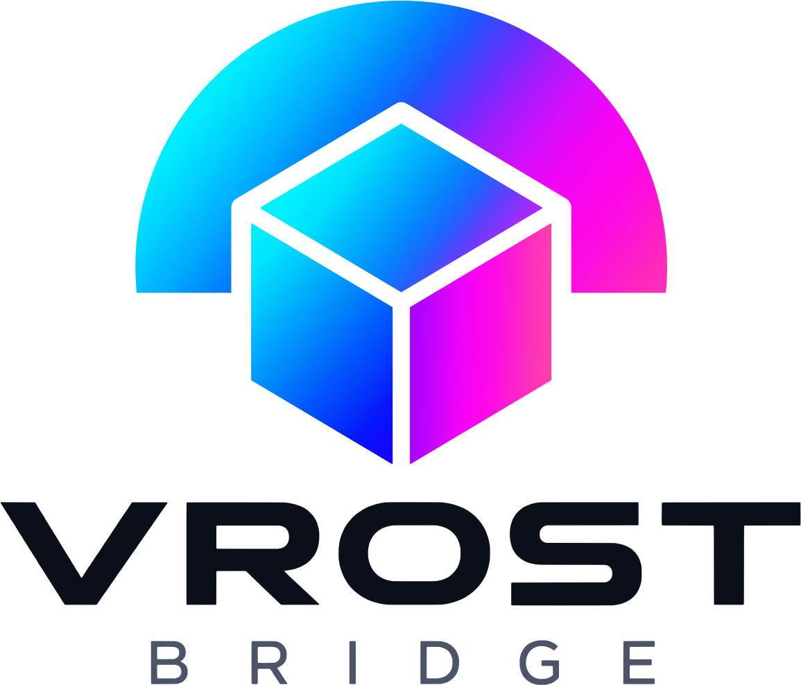
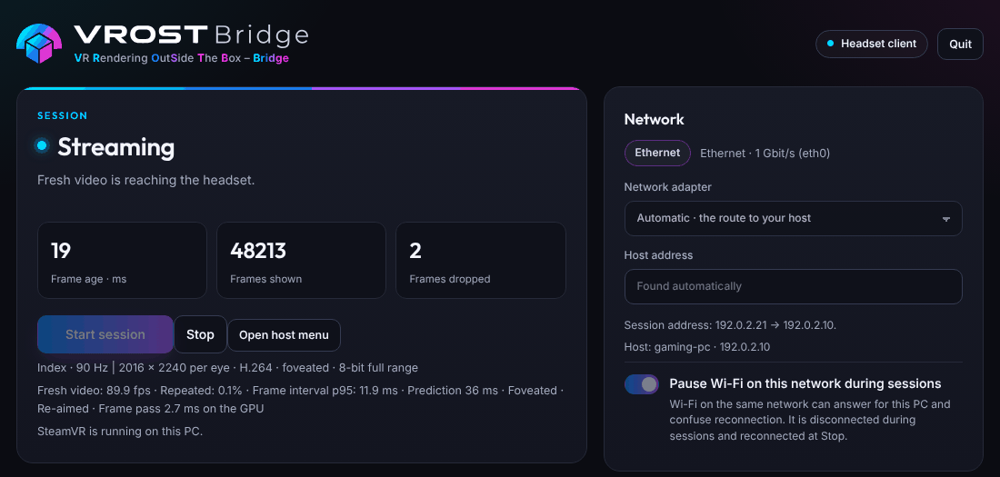
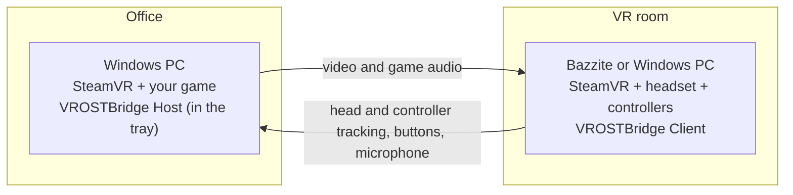

<p align="center">
  <picture>
    <source media="(prefers-color-scheme: dark)" srcset="brand/assets/logo/vrostbridge-logo.png">
    
  </picture>
</p>

# VROSTBridge

**VR outside the box.**  
*Think outside the box. Render there too.*

<p align="center">
  <b>Your gaming PC is in one room. Your VR headset is in another. VROSTBridge carries the frames down the hall.</b><br>
  Free and open source (MIT) · Windows rendering PC → Bazzite Linux or Windows headset PC · tested with Valve Index and Bigscreen Beyond 2e
</p>

VROSTBridge streams SteamVR games from a Windows PC to a PC VR headset that is plugged into a second, smaller
computer somewhere else in the house, running Bazzite Linux or Windows. The big PC renders; the small one tracks you
and shows the picture. One button starts and stops both.

<p align="center">
  <br>
  <sub>The headset PC's page during a session (example values).</sub>
</p>

> **Heads up:** a hobby project, freshly public. It works in the house it was built in, it has a great many
> automated tests, and it has met exactly one set of hardware. Expect rough edges, and please tell us about them:
> [what works today](#what-works-today) is honest about which parts have met real hardware and which have only met
> the test suite.

## How it works

- The **headset PC** (a handheld, a mini PC, anything x86 that runs [Bazzite](https://bazzite.gg) or 64-bit
  Windows 10 or 11) has the headset, the controllers and the base stations. Its own SteamVR tracks you and drives the
  displays.
- The **rendering PC** (Windows) runs your game in SteamVR, encodes every frame and sends it over your home network.
- **VROSTBridge** sets up both ends and handles the fiddly bits: foveated encoding (eye-tracked on a Beyond 2e),
  10-bit colour, AV1/HEVC/H.264, a bitrate that asks only for what the picture needs, Wi-Fi tuning, a lighter frame
  pass so a headset's full resolution fits small headset PCs, the headset PC's power balanced during sessions, base
  stations switched on and off for you, waking the rendering PC, and a Steam Game Mode screen on Bazzite or a tray
  icon on Windows.



The streaming engine is [ALVR](https://github.com/alvr-org/ALVR), with a few patches, talking to a native client
written for VROSTBridge, built for Linux and for Windows. ALVR usually streams to standalone headsets like a Quest;
VROSTBridge points it at a proper PC VR headset plugged into a second PC.

## Why?

The big PC lives in the office, where its fans can hum to themselves. The VR room is a former conservatory: lots of
floor space, nothing to trip over, and the best natural light in the house, which is completely wasted on someone
wearing a headset. A cable down the hall was never going to happen.

> **Conservatory owners, take note:** never leave a headset where sunlight can reach its lenses. They focus it onto
> the displays like a magnifying glass and can burn them. Bright sun can also confuse the base stations. Blinds are
> your friend.

## The name

**VROSTBridge** is *VR Rendering OutSide The Box – Bridge*. Yes, the B is doing two jobs: it is the Box and the
Bridge. That is about as loose as an acronym gets, and we're keeping it.

## What works today

| | Status |
| --- | --- |
| **Bazzite headset PC, Desktop Mode** | Used on the maintainer's setup with a Valve Index and a Bigscreen Beyond 2e: picture, tracking, Index controllers, game audio, eye-tracked foveation and the headset microphone, and 1.0.0.11 at Native (2560 per eye) with eye-tracked foveation. 1.0.0.12's changes (the automatic bitrate, the headset PC's GPU clock, the host's add-on warning) have passed their tests in software and await their first session. |
| **Steam Game Mode on Bazzite** | Included, but starting a session from Game Mode hasn't worked yet on the tested setup. Use Desktop Mode for now. |
| **Windows headset PC** | Built and tested in software only (its installer, page and frame path run in the tests under Wine); it has never met a real Windows headset PC. Brave volunteers wanted. |
| **Rendering PC** | Tested with an AMD Radeon (its AMF encoder). NVIDIA and Intel encoders should work through ALVR but haven't been tried. |
| **Headsets and controllers** | Valve Index and Bigscreen Beyond 2e, with Index controllers and SteamVR base stations. Other Lighthouse headsets that work in SteamVR on the headset PC should work too, but haven't been tried; other controllers aren't supported yet. |

## What you need

- A **rendering PC** with Windows and SteamVR, on a cable. No headset here: that's the point.
- A **headset PC** running [Bazzite](https://bazzite.gg) or Windows 10 or 11 (64-bit), with **your headset already
  working in SteamVR on it**. If it doesn't work there, it won't work streamed.
- A **PC VR headset** with Valve Index controllers and SteamVR base stations.
- A **home network** that both PCs share.

## Minimum and recommended specs

What we expect, from how VROSTBridge works and from the one setup it has been tested on. The minimums are educated
guesses, not promises: if yours works (or doesn't), tell us and this table gets better.

| | Minimum (expected) | Recommended | Tested |
| --- | --- | --- | --- |
| **Rendering PC** | Windows 10 (64-bit) with SteamVR, and a GPU that runs your games in VR and has a hardware video encoder (AMD, NVIDIA or Intel) | Windows 11 and an AMD Radeon (the tested encoder path). For AV1: an AMD RX 7000 or NVIDIA RTX 40 series or newer | Windows, an AMD Radeon desktop GPU |
| **Headset PC** | A 64-bit x86 PC with 4 CPU cores and 8 GB of RAM. On Bazzite, a GPU that decodes HEVC through VA-API and drives the headset (AMD with Mesa). On Windows 10 or 11 (64-bit, not yet tested on hardware), SteamVR and a GPU whose Vulkan driver works with SteamVR and whose Direct3D 11 video decoder handles the chosen codec | On Bazzite, a recent AMD Radeon, integrated or discrete. 6–8 cores and 16 GB of RAM if you use eye tracking. On a handheld, a power limit of 20 W or more | A Ryzen handheld with integrated Radeon graphics, on Bazzite. Windows: not yet |
| **Headset** | A Lighthouse-tracked headset that works in SteamVR on the headset PC over DisplayPort, with Index controllers and base stations | Valve Index, or Bigscreen Beyond 2e (eye-tracked foveation needs the 2e) | Both |
| **Network** | Both PCs on one home network: the same IPv4 subnet, with private addresses (192.168.x.x, 10.x.x.x or 172.16–31.x.x). The rendering PC wired. A path that carries about 80 Mbit/s cleanly | Both PCs on 1 Gbit/s Ethernet, or the headset PC on Wi-Fi 6, 6E or 7 at 5 or 6 GHz, in the same room as the access point | 1 Gbit/s USB Ethernet adapter; Wi-Fi 7 |

- **Bandwidth:** the stream uses 10 to 300 Mbit/s. A 15-second network test picks the rate from what the path carries
  cleanly: roughly 30–50 Mbit/s from a path clean at 80, about 120 from one clean to 300, up to the 300 maximum on a
  fast wired path.
- **Not supported:** 2.4 GHz Wi-Fi, PCs on different subnets or VLANs, guest networks that keep devices apart, and the
  internet in between.
- **Headset PC GPUs:** on Bazzite, NVIDIA is not expected to work, because its Linux driver has no VA-API decoding of
  its own, and Intel is untested. On Windows no GPU has been tested yet.
- **Windows headset PC:** each decoded picture is copied through system memory on its way to the headset, which costs
  some memory bandwidth. AV1 and 10-bit colour need a GPU whose video decoder offers them. No Visual C++ runtime is
  needed.
- **Handhelds:** decoding, SteamVR and eye tracking share one power limit, so raise it. The page tells you when the
  graphics or processor are held back, and shows the picture a little smaller rather than halving the frame rate
  while they are.
- **Disk:** about 100 MB on the rendering PC and on a Bazzite headset PC, about 63 MB on a Windows one. Eye tracking
  adds about 0.85 GB for Baballonia (0.88 GB on Windows).

The details behind every line are in the [technical reference](docs/TECHNICAL_REFERENCE.md#19-requirements).

## Getting started

From [Releases](../../releases), download one file for each PC, both of the same version:

| PC | File |
| --- | --- |
| Rendering PC (Windows) | `VROSTBridge-Host-Setup-<version>.exe` |
| Headset PC with Bazzite | `VROSTBridge-Bazzite-Installer-<version>.zip` |
| Headset PC with Windows | `VROSTBridge-Client-Setup-<version>.exe` |

Portable ZIPs of both Windows programs are there too, if you'd rather not install, and `SHA256SUMS.txt` lets you
check your downloads.

1. **Headset PC first:** check the headset and both controllers work in SteamVR on the headset PC. On Windows, run
   SteamVR there once with the headset connected and finish its room setup.
2. **Rendering PC:** run the host setup. It isn't code-signed, so Windows may say *Windows protected your PC*: choose
   **More info → Run anyway**. VROSTBridge Host then waits in the system tray.
3. **Headset PC:** on Bazzite, extract the whole ZIP and open **Install VROSTBridge.desktop**. On Windows, run the
   client setup (**More info → Run anyway** again); it installs for your account only and needs no administrator
   rights.
4. **Open VROSTBridge** on both PCs and allow the home-network firewall step if asked: on the headset PC that is
   **Allow home-network connection** on its page (one administrator prompt on Windows). They find each other.
5. On the headset PC choose **Use recommended settings**, then press **Start session**. The first time, it tests your
   network for about 15 seconds. The rendering PC's SteamVR appears in your headset.
6. Play. **Stop session** on the headset PC ends it on both. On Windows the client's tray icon starts and stops
   sessions too.

More: [quick start](docs/QUICK_START.md), [installing and upgrading](docs/INSTALL_PACKAGES.md),
[Game Mode](docs/BAZZITE_PLAY.md) and [troubleshooting](docs/TROUBLESHOOTING.md).

**Play safe.** Check the view, tracking and play-space boundaries before active VR, and stop if they become
unreliable. Follow your headset maker's safety guidance.

## Optional extras

- **Eye tracking (Beyond 2e).** Turn on *Eye tracking* and VROSTBridge offers to download
  [Baballonia](https://github.com/Project-Babble/Baballonia) by Project Babble (personal, non-commercial licence,
  accepted before anything downloads). Calibrate once during a session, turning your head well round while you follow
  the dot, and the sharp part of every frame follows your eyes. On a Windows headset PC, close Bigscreen's own
  eye-tracking app first: Baballonia reads the eye cameras itself. [Details](docs/BEYOND_EYE_TRACKING.md).
- **Your headset's microphone on the rendering PC.** One button downloads [VB-CABLE](https://vb-cable.com) from
  VB-Audio and opens its setup (donationware: consider supporting its author).
- **Wake-on-LAN, keep-awake and quick resume**, so the rendering PC can sleep until you want it.
- **Base stations off when you're done.** SteamVR 2.0 base stations wake as a session starts and go to sleep when
  VROSTBridge closes, over the headset PC's Bluetooth (a switch on the *This PC* card).

## Questions people ask

- **So it's a very long HDMI cable?** Morally, yes. Technically it is a video encoder, a network, a decoder, a frame
  re-aimed to where your head is now, and about 40 milliseconds of travel, so fast games feel a little further away
  than on a cable.
- **Blurry or stuttery?** Choose **Use recommended settings**, try a cable for the headset PC, check the *Network*
  card, keep a handheld on its charger, or pick a smaller size. The [troubleshooting](docs/TROUBLESHOOTING.md) page has
  the rest.
- **Something broke?** On the client page choose **Send report to host**, save both reports on the host page, and open
  an issue with them. Reports contain local network addresses and hardware names, so look before posting publicly.
- **Over the internet?** No, and please don't port-forward it. It is built for a trusted home network, and the
  internet adds exactly the kind of delay VR hates.
- **Do I need a Quest?** Nope. That is what ALVR is for. VROSTBridge is for the PC VR headset you already have.
- **Can the headset PC run Windows?** Yes: Windows 10 or 11, 64-bit. That client hasn't met real hardware yet, so
  reports from yours are very welcome.
- **My headset isn't on the list.** If it works in SteamVR on the headset PC with Index controllers and base stations,
  try it and tell us. Other controllers aren't supported yet.

## Security and privacy

- Everything stays on your home network. The pages are for your own PCs only, actions are checked, and the two PCs
  pair before they stream.
- No accounts, no telemetry, no cloud. VROSTBridge only goes online to download what you ask for (Baballonia from
  Project Babble, VB-CABLE from VB-Audio), and checks each before use.
- Eye-camera pictures never leave the headset PC. Only the direction you look travels, inside the stream, to steer the
  sharp region. Where you looked is never logged: logs and reports keep only how far your gaze reached each way.

Found a security problem? See [SECURITY.md](.github/SECURITY.md).

## Documentation

The [documentation](docs/README.md) covers everything behind this page: the guides above, how it all works (the
[technical reference](docs/TECHNICAL_REFERENCE.md), with exactly where it differs from ALVR, SteamVR, Baballonia and
a directly connected headset), building from source, and the project's history.

## Building from source

Most people want the [Releases](../../releases). To build: [docs/BUILDING.md](docs/BUILDING.md) (the native client
for Linux and Windows, the Windows driver from the pinned ALVR source plus `patches/`, and the companions) and
[packaging/README.md](packaging/README.md). Each release also offers the source split by part (rendering PC, Windows
headset PC, Bazzite headset PC). Checks a fresh clone can run:

```sh
python3 -m unittest discover -s tests -p 'test_*.py'
node tests/test_desktop_ui.js
cmake -S . -B build-tests -DVROST_BUILD_LINUX_CLIENT=OFF && cmake --build build-tests && ctest --test-dir build-tests
```

[CONTRIBUTING.md](.github/CONTRIBUTING.md) says how to help.

## Thank you

- [ALVR](https://github.com/alvr-org/ALVR) for the streaming engine, protocol and host driver.
- Valve's [OpenVR](https://github.com/ValveSoftware/openvr), [FFmpeg](https://ffmpeg.org/), [SDL](https://libsdl.org/),
  [Wayland](https://wayland.freedesktop.org/), [stb](https://github.com/nothings/stb), and the
  [Inter](https://github.com/rsms/inter) and [Outfit](https://github.com/Outfitio/Outfit-Fonts) typefaces.
- [go-bsb-cams](https://github.com/LilliaElaine/go-bsb-cams) by LilliaElaine for the Beyond 2e eye cameras, and
  [Project Babble](https://github.com/Project-Babble/Baballonia) for Baballonia.
- [Bazzite](https://bazzite.gg) and gamescope, for a Linux that makes this possible on a handheld.

Every component and its licence: [THIRD_PARTY.md](THIRD_PARTY.md) and [docs/OPEN_SOURCE_CREDITS.md](docs/OPEN_SOURCE_CREDITS.md).

## Licence

MIT, Copyright (c) 2026 JagerBombastic: see [LICENSE](LICENSE). Third-party components keep their own licences and
notices ([NOTICE](NOTICE), [THIRD_PARTY.md](THIRD_PARTY.md)); [licences in plain words](docs/LICENSING.md) explains
what that means for you. The logo, icons and other artwork are © 2026 JagerBombastic under
[CC BY-ND 4.0](brand/LICENSE.md): share them unchanged, with credit; a fork uses its own name and logo.

> VROSTBridge is an independent open-source project. It is not affiliated with, sponsored by or endorsed by Valve
> Corporation, Bigscreen, or any other headset, tracking-system or platform maker, nor by the ALVR project, Project
> Babble, VB-Audio or Universal Blue (Bazzite). Product names and trademarks belong to their owners; mentioning Valve
> Index, SteamVR, Steam or Bigscreen Beyond describes compatibility, not endorsement or certification. Compatibility
> is limited to the hardware and software documented for each release.
