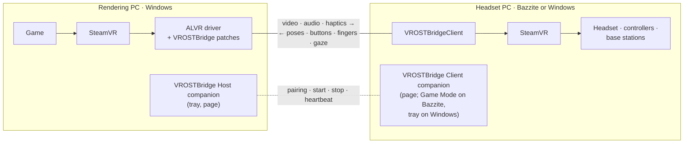
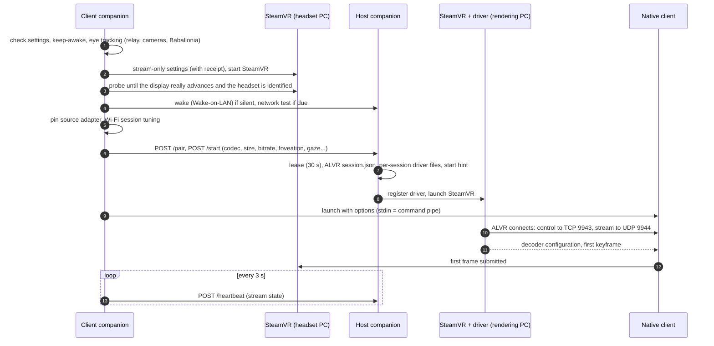
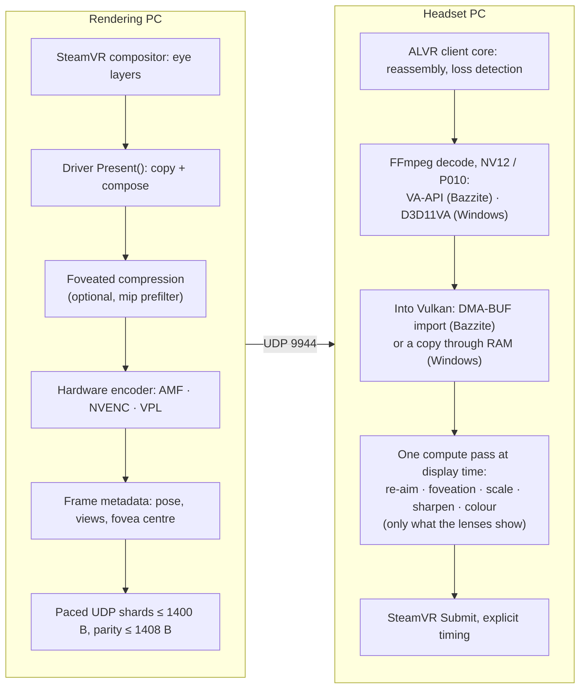
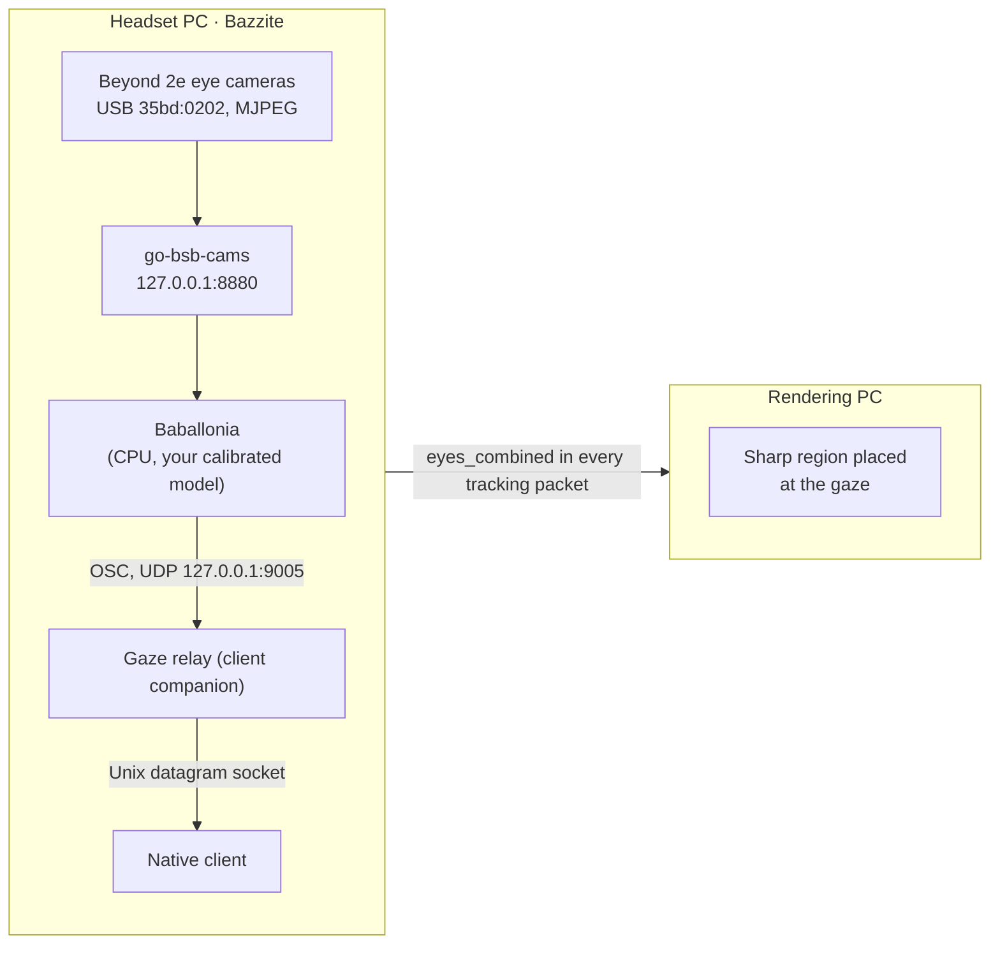

# VROSTBridge technical reference

For VROSTBridge **1.0.0.12** (every package shares one version: host, Bazzite client and Windows client). This is the engineer's view: how the parts fit together, what travels between them, where the numbers come from, and exactly where VROSTBridge departs from the software it is built on. The [README](../README.md) is the short tour, the [quick start](QUICK_START.md) is for setting it up, [BUILDING.md](BUILDING.md) has the build steps in full, and the [project specification](PROJECT_SPEC.md) records the decisions and their history. When this document and the code disagree, the code wins and this document has a bug.

**Contents**

- Part 1 — How it works
  - [1. The system in one page](#1-the-system-in-one-page)
  - [2. Components and source layout](#2-components-and-source-layout)
  - [3. Session lifecycle](#3-session-lifecycle)
  - [4. Networking: ports, protocols and trust](#4-networking-ports-protocols-and-trust)
  - [5. Tracking and input](#5-tracking-and-input)
  - [6. The video pipeline](#6-the-video-pipeline)
  - [7. Timing and latency](#7-timing-and-latency)
  - [8. Foveated encoding](#8-foveated-encoding)
  - [9. Eye tracking (Bigscreen Beyond 2e)](#9-eye-tracking-bigscreen-beyond-2e)
  - [10. Colour](#10-colour)
  - [11. Audio and microphone](#11-audio-and-microphone)
  - [12. Network test, automatic bitrate and Wi-Fi](#12-network-test-automatic-bitrate-and-wi-fi)
  - [13. Power, sleep and wake](#13-power-sleep-and-wake)
  - [14. The companions and their user interfaces](#14-the-companions-and-their-user-interfaces)
  - [15. Diagnostics and reports](#15-diagnostics-and-reports)
  - [16. Installation, upgrades and stored state](#16-installation-upgrades-and-stored-state)
  - [17. Security and privacy](#17-security-and-privacy)
  - [18. Building and testing](#18-building-and-testing)
  - [19. Requirements](#19-requirements)
  - [20. Validation status and known limits](#20-validation-status-and-known-limits)
- Part 2 — Where VROSTBridge differs
  - [21. From ALVR](#21-from-alvr)
  - [22. From ALVR's usual clients](#22-from-alvrs-usual-clients)
  - [23. From a directly connected headset](#23-from-a-directly-connected-headset)
  - [24. From SteamVR's defaults on the headset PC](#24-from-steamvrs-defaults-on-the-headset-pc)
  - [25. From Baballonia's usual setup](#25-from-baballonias-usual-setup)
  - [26. From other ways to play PC VR away from the PC](#26-from-other-ways-to-play-pc-vr-away-from-the-pc)
  - [27. Ease of use and setup](#27-ease-of-use-and-setup)
- Part 3 — Reference tables
  - [28. Settings and their defaults](#28-settings-and-their-defaults)
  - [29. Files and folders](#29-files-and-folders)
  - [30. Log lines](#30-log-lines)
  - [31. Glossary](#31-glossary)

---

# Part 1 — How it works

## 1. The system in one page

VROSTBridge connects two PCs on one home network:

- The **rendering PC** (Windows) runs the game in SteamVR. SteamVR there does not see a real headset: it sees a *virtual* one provided by ALVR's SteamVR driver, patched by VROSTBridge. The driver captures each finished frame, compresses it with the GPU's hardware encoder and sends it out.
- The **headset PC** (Bazzite Linux, or from 1.0.0.7 Windows 10 or 11) has the real headset, controllers and base stations, and runs its own SteamVR. That SteamVR tracks you and drives the displays exactly as it would for a local game. VROSTBridge's native client is the "game" it runs: it sends your poses to the rendering PC, decodes the frames that come back, and hands them to the local SteamVR to show.

So there are **two SteamVRs**, one per PC, each doing what it is good at. Poses flow one way, pictures the other, and a pair of companion programs (one per PC) set everything up, start and stop both ends together, and watch over the session.

The headset PC's software is built from one source for both systems. The two builds behave the same on the network and in the headset; they differ in how video is decoded (§6.4), how the eye cameras are read (§9), how Wi-Fi and power are tuned (§12.4, §13.2) and how they install (§16.3). Steam's Game Mode is a Bazzite feature; on Windows the companion lives in the tray.

Four ideas carry most of the design:

1. **Reuse a proven streaming engine.** The protocol, encoder plumbing and SteamVR driver are ALVR's. The client links ALVR's own Rust client core, so both ends speak the same protocol from the same pinned source. VROSTBridge's patches change behaviour where a PC VR headset on a second PC needs it (§21).
2. **Let the headset's own SteamVR stay in charge of the headset.** Lens distortion, display timing, the boundary and reprojection all stay with the SteamVR that owns the hardware. VROSTBridge never invents lens or panel constants.
3. **Predict once, correct late.** Poses are sampled fresh on the headset PC and labelled with the time they are expected to be shown. The rendering PC predicts *once* to that time. When the frame arrives, the client turns it to the newest head rotation just before it is shown (§7).
4. **One button, both PCs.** Everything a session needs, on both machines, is started, checked and put back by the companions, with plain-language messages when something is wrong (§27).

## 2. Components and source layout

| Component | Runs on | Language | What it does | Source |
| --- | --- | --- | --- | --- |
| Host driver (`driver_alvr_server.dll`) | Rendering PC, inside SteamVR | Rust + C++ | ALVR's SteamVR driver with VROSTBridge's patches (20 of the 23 change the driver): the virtual headset and controllers, capture, foveation, hardware encoding, the network side of the stream | `upstream/ALVR` (pinned) + `patches/` |
| Host companion (`VROSTBridge Host.exe`) | Rendering PC | C launcher + Python | Tray icon, local page, driver registration, firewall rules, ALVR settings, starting and stopping SteamVR, session broker, Wake-on-LAN readiness, microphone set-up, reports | `packaging/windows-launcher.c`, `launcher/`, `host/` |
| Host helpers | Rendering PC | C++ | `VROSTBridgeVRHelper.exe` (play-area rectangle through OpenVR), `VROSTBridgeAudioProbe.exe` (audio endpoints) | `host/vr_helper.cpp`, `host/audio_probe.cpp` |
| Native client (`VROSTBridgeClient`, `VROSTBridgeClient.exe` on Windows) | Headset PC | C++17 + Vulkan | SteamVR scene application: samples poses, sends input, decodes video (FFmpeg with VA-API on Bazzite, D3D11VA on Windows), runs the one-pass frame shader, submits frames to SteamVR, draws the in-headset status card | `client/`, `core/` |
| Client transport (`libvrostbridge_transport.so`, `vrostbridge_transport.dll` on Windows) | Headset PC | Rust | ALVR's client core behind a small C interface owned by VROSTBridge (no ALVR types cross it). One source for both systems | `client/transport/` |
| FFmpeg 6.1.4 (`avcodec`, `avutil`, `swscale`) | Headset PC | C (third party) | Video decoding: a minimal LGPL build with only the H.264, HEVC and AV1 decoders, with VA-API and Vulkan on Bazzite, D3D11VA and Vulkan on Windows (cross-compiled with mingw-w64). Unmodified source | `third_party/ffmpeg/` (source and build notes) |
| Runtime probe (`VROSTBridgeRuntimeProbe`) | Headset PC | C++ | Checks SteamVR's stream-only settings and measures the real display refresh before a session | `client/platform/linux/runtime_probe.cpp` (both systems) |
| Lease helper (`VROSTBridgeLease`) | Headset PC, Bazzite's Game Mode | C++ | Receives the headset's display lease from gamescope and offers it to SteamVR over a private Wayland socket | `client/platform/linux/lease.cpp` |
| Client companion (`VROSTBridge-Client` on Bazzite, `VROSTBridge Client.exe` on Windows) | Headset PC | Python (frozen on Bazzite; C launcher + embedded Python on Windows) | Local page, Game Mode screen (Bazzite) or tray icon (Windows), discovery and pairing, the start sequence on both PCs, network test, Wi-Fi tuning, power, eye tracking, reports | `launcher/`, `packaging/windows-launcher.c` |
| Eye-camera helper (`go-bsb-cams`) | Headset PC (Bazzite) | Go | Reads the Beyond 2e's eye cameras over USB and serves them as MJPEG on 127.0.0.1 | `third_party/go-bsb-cams/` (modified) |
| Baballonia | Headset PC | .NET (third party) | Turns eye pictures into gaze angles (on Windows it reads the eye cameras itself). Downloaded on request, never bundled | Project Babble |
| Vulkan layer (`VK_LAYER_VROSTBRIDGE_openvr_textures`) | Headset PC (Bazzite) | C | Lets Baballonia's calibration program hand its picture to SteamVR as an overlay on Mesa | `client/platform/linux/openvr_texture_layer.c` |

Source tree, top level:

| Folder | Contents |
| --- | --- |
| `client/` | Native client: `platform/linux` (main loop, Vulkan, decoder, shaders, lease helper, probe; the main loop, Vulkan, decoder, shaders and probe also build the Windows client), `platform/windows` (D3D11VA decoding, the upload into Vulkan, process plumbing, version resource and manifest), `device` (OpenVR device, input, haptics, gaze, plane upload, diagnostics), `transport` (Rust C-ABI over ALVR's client core), `ui` (headset cards, `libvrosttext.so`) |
| `core/` | Header-only rules shared by client and tests: geometry, re-aim, stream continuity, presentation queue, EDID, version |
| `launcher/` | Both companions: `app.py` (application), `desktop.html` (the page), `game_ui.py` (Game Mode), plus one module per concern (network test, Wi-Fi, power, eye tracking, reports, installer maintenance, and the Windows client's network, power, firewall, tray and sign-in parts) |
| `host/` | Host-only companion parts: ALVR profile (`profile.py`), SteamVR control, event reader, stream options, power, QoS, microphone, PowerShell set-up script |
| `patches/` | The 23 ALVR patches, applied in order to the pinned checkout |
| `third_party/` | Vendored or pinned third-party code and sources: OpenVR, FFmpeg source (with the build notes of both systems), go-bsb-cams, stb, Wayland protocol |
| `packaging/` | Installers (host, Bazzite client, Windows client), launcher, PyInstaller spec, distribution builders |
| `scripts/` | Build and maintenance scripts (fetch and patch ALVR, cross-build the driver and the Windows client with its FFmpeg and transport, FFmpeg, packaging, PDFs) |
| `cmake/` | The clang-cl toolchain that cross-builds the Windows client on Linux |
| `tests/` | Python, C++, JavaScript and Rust tests |
| `docs/` | This document and the rest |
| `brand/`, `assets/`, `config/` | Logo and artwork, SteamVR action manifests, the eye-camera udev rule |

## 3. Session lifecycle

### 3.1 Idle

Between sessions the host companion sits in the tray with its session broker listening on port 9946. SteamVR on the rendering PC is closed (unless *Quick resume* is keeping it open, §3.5). VROSTBridge starts it and owns it for each session, and refuses to start while a SteamVR it did not start is running. The client companion shows its page (or Bazzite's Game Mode screen, or just its tray icon on Windows) and nothing runs in the headset until you press **Start session**.

### 3.2 Discovery and pairing

- **Finding the host.** The client sends a small JSON probe (`{"protocol": "vrostbridge-session-2", "nonce": …}`) to the directed broadcast address of each connected physical private IPv4 network, from port 9946, pinned to that adapter. The host answers only probes from inside one of its own directly attached subnets. Exactly one answer is used. More than one asks you to type the host's address, and none explains the firewall and offers the same. A last-known address is tried first.
- **Pairing.** The client has a random 32-hex-digit ID and a 64-hex-digit token, kept in its state folder (mode 0600 on Bazzite; on Windows in the user's own `%LOCALAPPDATA%`). It presents both to `POST /pair`. The host stores the client ID with a **SHA-256 of the token** (never the token), at most 16 clients. A new client is accepted only when *Allow home-network clients* is on and Windows classes the adapter the request arrived on as a **Private** network. VROSTBridge never changes that classification itself.
- **ALVR trust.** ALVR keeps its own list of trusted clients (by ALVR hostname, e.g. `1234.client.local.`). With automatic connection on, the host trusts the client for the session and records its address for reconnection. With it off, the host page shows the client with **Allow & connect**.

### 3.3 Start

Pressing **Start session** on the headset PC runs one ordered sequence across both PCs. Any failure rolls the whole thing back to a clean stop.

Notes on the steps:

- **Headset first.** The local SteamVR is (re)started with stream-only settings (§24) and probed for up to 60 seconds until its display really advances at the reported refresh and a headset identity is available. The Bigscreen Beyond reports 90 Hz while running at 75 Hz, so the measured rate wins (§6.6).
- **Host in parallel.** When a headset was seen before, the host side starts in parallel with that headset's profile to save time. It restarts if the headset turns out to be different.
- **No SteamVR restart for new displays.** Upstream ALVR restarts SteamVR when a client with a new display connects. VROSTBridge writes a start-up hint (`vrostbridge-init.json`) that the patched driver applies before it registers the headset (patch 0015), so the first connection already matches.
- **The lease.** The host gives the session a 30-second lease that the client renews every 3 seconds. If the heartbeats stop (client crashed, network gone) the host stops its SteamVR on its own.
- **On a Windows headset PC.** SteamVR is found through `%LOCALAPPDATA%\openvr\openvrpaths.vrpath`, OpenVR's list of installations: the registered runtime's `bin\win64` holds its programs, and the first configuration folder holds `steamvr.vrsettings`. It is started with its own `vrstartup.exe` (through Steam only when that is missing), and its processes are identified by exact image path and creation time. SteamVR writes that file when it first runs, so on a PC where it never has, Start says so in plain words. The native client starts directly (Bazzite's SteamVR environment wrapper has no Windows counterpart), and with eye tracking the gaze reaches it on a UDP port on 127.0.0.1 (§9.1). Game Mode's display reservation and lease (§14.3) are Bazzite's: SteamVR on Windows drives the headset itself.

### 3.4 Running

- **Client supervision (every second):** whether fresh video is arriving, the graphics-limit and power checks (§13), the session timeline (§15), the status line in the headset, and the health of the local SteamVR. If the local compositor or SteamVR crashes, the companion records why (§15.1) and restarts the session automatically. A second crash within ten minutes stops it with an explanation rather than looping.
- **Host supervision (every 0.75 s):** the SteamVR processes it started (identified by PID, image path and creation time, so PID reuse cannot fool it), ALVR's own health, and requests to restart. If a SteamVR it did not start appears, the session ends and that SteamVR is left alone.
- **Stream recovery:** when the client reports no video and ALVR shows the client disconnecting for 8 s (or 20–45 s in other states), the host restarts its SteamVR, at most twice per session and at least 180 s apart.
- **Headset not tracked:** when the headset PC's SteamVR stops reporting a head pose for 2 s, both pages and the headset say so, with the likely reason from OpenVR's tracking result (base stations not seen, out of range, calibrating). The host counts frames it had to drop for lack of a pose (patch 0018) and shows *Waiting for the headset's position*.

### 3.5 Stop and quick resume

**Stop session** on the headset PC stops the native client, the local SteamVR (only processes this session started) and the host session, then puts back everything that was changed for the session: SteamVR settings, Wi-Fi power saving, access-point lock, paused adapters, default audio devices, sleep inhibitors and power profile (on Windows: Wi-Fi's media streaming mode and background scanning, paused adapters, the keep-awake request and the power mode, §12.4 and §13.2). Windows has no SIGTERM, so there the companion writes `quit` to the native client's standard input and waits up to 8 s (then closes the pipe, which also stops it, and ends the process only as a last resort), and asks SteamVR to quit with `vrmonitor://quit`, waiting up to 13 s before it ends only the verified processes this session started. With **Quick resume** set (5–60 minutes), the host keeps its SteamVR running ("parked") after a stop and reuses it if the next session asks for the same settings. Games on the host keep running in the meantime.

## 4. Networking: ports, protocols and trust

### 4.1 Ports

| Port | Protocol | Listener | Purpose |
| --- | --- | --- | --- |
| 9943 | TCP | Headset PC (ALVR client core) | ALVR control channel. The **host connects to the client** |
| 9944 | UDP | Both (client listens, host connects) | ALVR stream: video, audio, tracking, haptics, statistics. Also used by the network test between sessions |
| 5353 | UDP | Both | mDNS: the client announces `_alvr._tcp.local.`, the host browses |
| 9946 | TCP + UDP | Rendering PC | VROSTBridge session broker (HTTP) and discovery (UDP) |
| 9945 | TCP | Headset PC | Read-only diagnostics for the session's host (summary and report) |
| 9947 / 9948 | TCP | 127.0.0.1 only | The client's / host's local page |
| 8082 | TCP | 127.0.0.1 only (rendering PC) | ALVR's local web API, used only by the host companion |
| 9005 | UDP | 127.0.0.1 only (headset PC) | Gaze relay: Baballonia's OSC output |
| Any free port | UDP | 127.0.0.1 only (Windows headset PC) | Gaze from the relay to the native client, a port chosen at each Start and bound by the client for its exclusive use (Bazzite uses a Unix socket instead, §9.1) |
| 8880 | TCP | 127.0.0.1 only (Bazzite headset PC) | Eye-camera MJPEG stream while eye tracking runs |
| 9 and 7 | UDP | — | Wake-on-LAN magic packets (sent, not listened for) |

**Firewalls.** On the Windows rendering PC, one administrator prompt creates five inbound rules, all limited to the **Private** profile and the local subnet: TCP and UDP 9943–9944 and UDP 5353 for SteamVR's `vrserver.exe`, and TCP and UDP 9946 for the bundled Python. Each is marked with an ownership description, so uninstalling removes only VROSTBridge's own. On a Bazzite headset PC, firewalld rich rules (9943/tcp, 9944/udp, 5353/udp, 9945/tcp, 9946/udp, limited to each observed private subnet) are added only when you press **Allow home-network connection**, which asks for your password, and are recorded so they can be removed.

On a Windows headset PC the same button asks for administrator permission once (UAC) and creates five inbound rules named `VROSTBridge.Client.*`, again Private profile and local subnet only, each limited to its program and to the Bazzite client's ports: TCP 9943, UDP 9944 and UDP 5353 for `VROSTBridgeClient.exe` (ALVR control, the UDP stream, mDNS), and TCP 9945 and UDP 9944 and 9946 for the companion's Python (diagnostics, the network test's receiver and session-discovery replies). They carry an ownership description of their own, so they never touch the host's rules on a PC that has both, and the uninstaller removes them (one more prompt). The client's firewall check also reports adapters whose network Windows classes as Public, where the rules do not apply, and block rules for either program, which a declined Windows Firewall prompt leaves behind and which win over allow rules.

### 4.2 The session broker (client → host, HTTP on 9946)

Every request carries `X-VROSTBridge-Session: 1` and no `Origin` header, must come from a peer inside one of the host's directly attached private subnets, and is size-limited (8 KiB; reports 6 MiB compressed). Unknown fields are refused. The protocol name is `vrostbridge-session-2`.

| Endpoint | Purpose |
| --- | --- |
| `GET /hello` | Host identity, protocol, capabilities and feature list (what the installed driver and companion support) |
| `POST /pair` | Pair or re-authenticate (client ID + token) |
| `POST /start` | Start a session with the chosen settings. Returns at once while the host starts. Idempotent per request ID |
| `POST /heartbeat` | Renew the 30-second lease and report the stream's state (up, down time). From 1.0.0.8 it may carry `bitrate`, the bitrate the client wants now (whole Mbit/s, 10–300), for hosts that list `bitrate-control` (§12.6) |
| `POST /stop` | Stop the session |
| `POST /status` | Host session state (also used to recover a lost Start reply) |
| `POST /linktest` | Run the network test's sending side (between sessions only, one at a time) |
| `POST /report` | Upload a client report (gzip JSON, ≤16 MiB decoded, at most 20 kept) |
| `POST /fovea` | The live eye view for the host page (lease owner only, ≤ 12 a second, memory only) |

A host and client with different session protocols refuse each other with *Install this release on both PCs*. Within one protocol, the `capabilities` and `features` lists let a client leave out options an older driver would not understand, but the supported combination is the same release on both PCs.

### 4.3 The ALVR stream

- **Control:** framed messages (u32 little-endian length + bincode) on TCP 9943, keep-alive every 500 ms. Patch 0002 adds a 750 ms write deadline, a 16 MiB frame cap, prompt end-of-stream detection, and a **media grace**: a silent control channel no longer ends a session while video or statistics still arrived within 500 ms, for up to 6 s.
- **Stream:** UDP 9944 (TCP only for wired/loopback ALVR clients, which VROSTBridge does not use). Datagrams of up to 1400 bytes carry shards of five multiplexed streams: tracking (0, client → host), haptics (1), audio (2, both ways), video (3) and statistics (4). ALVR is told to mark the stream DSCP EF (Expedited Forwarding). On the rendering PC, Windows honours that only with the optional video-priority policy (§12.5). Patch 0009 paces the video stream so a frame leaves at the link's rate instead of one line-rate burst.
- **Identity:** the protocol ID is `21-dev14-vrostbridge-native-1` (ALVR's `21-dev14` + VROSTBridge's suffix, patch 0005). VROSTBridge extends ALVR's tracking packet with native controller bones (patch 0003), so it deliberately refuses stock ALVR peers rather than misreading their packets.
- **Discovery direction:** as in upstream ALVR, the *client* announces itself over mDNS and the *host* connects to it. The host companion also gives ALVR the client's address directly, so reconnection does not depend on multicast.
- **Pinning:** on the headset PC the companion picks one source address on one physical adapter and passes it to the native client (`VROSTBRIDGE_BIND_IP`, `VROSTBRIDGE_INTERFACE`, patch 0002), so a second adapter (Wi-Fi beside Ethernet, say) cannot quietly carry half the stream. Patch 0002 applies the interface on Linux only; on Windows the transport binds to the source address alone.

## 5. Tracking and input

### 5.1 Pose sampling

The native client's tracking thread asks the local SteamVR for the **current** pose of the headset and both controllers (`GetDeviceToAbsoluteTrackingPose`, standing universe, 0 s ahead) on a grid locked to the headset's display:

| Refresh | Samples per frame | Samples per second |
| --- | --- | --- |
| 75 Hz | 4 | 300 |
| 90 Hz | 4 | 360 |
| 120 Hz | 3 | 360 |
| 144 Hz | 2 | 288 |

The rule is N = ceil(frame period / 3.5 ms), between 1 and 8. The grid is re-anchored to the measured vsync once a second. If the host keeps picking samples from a different slot, the grid shifts by half a spacing (at most 8 times). On Windows the tracking thread sleeps on a high-resolution waitable timer, because the standard sleep there wakes only in whole milliseconds, and the client asks for a 1 ms timer resolution, above-normal priority, the multimedia scheduler's *Games* task for its frame loop and no power throttling.

Each sample carries position, orientation, linear and angular velocity, and a **time label**: the acquisition time plus the expected pipeline latency (ALVR's running average, capped at 100 ms, strictly increasing). The rendering PC extrapolates once to that label (§7.3). Poses that SteamVR's compositor predicted for its own display (`WaitGetPoses`) are used only to aim the frame being shown and are never forwarded.

Only the headset and the two controller roles are forwarded. **Trackers (Vive trackers and similar) are not.** Without a head pose nothing is sent, which is what drives *Headset not tracked* (§3.4).

### 5.2 Buttons, sticks and the menu

The client uses SteamVR Input with its own action manifest and the **Valve Index controller** profile. That gives 18 inputs per hand: trigger (value, touch, click), grip (value, force), trackpad (x, y, force, touch), thumbstick (x, y, click, touch), A and B (click, touch) and system. They are sent when they change (by more than 10⁻⁴) and as a full refresh every 250 ms. Everything is released if the controller disconnects or an action update fails, or input focus is lost for half a second or more, so a button cannot stick down across a dropout; a shorter loss of focus keeps the last values of every control but the system button (1.0.0.10). The system button opens the **rendering PC's** SteamVR menu (the headset PC's own dashboard is off during a session, §24). *Open host menu* on the page and the chord *left B + left stick click* do the same.

While the system button is held, the headset PC's own SteamVR takes input focus from the client (it shows its recentre indicator, ready for a long press), and without focus the actions read as released. Up to 1.0.0.9 that cut the press short on the rendering PC, or lost it, so its menu opened only sometimes. From 1.0.0.10 a press is forwarded for at least 0.12 s and ends with a release the client has seen: read with focus, or reported by SteamVR's own button event (`VREvent_ButtonPress`/`ButtonUnpress`, which `sendSystemButtonToAllApps` sends to applications; that they arrive while SteamVR holds focus is still to be confirmed on hardware), which the client now also reads. A press whose end cannot be read is sent as a tap, and one physical press is never sent twice. The rendering PC's SteamVR then opens its menu on a short press and, whenever the client can follow the press, recentres on a long one, as with a directly connected headset. Each press is logged as `SYSTEM_BUTTON` (§30.1).

### 5.3 Index finger tracking

Upstream ALVR builds SteamVR's finger bones from a 26-joint OpenXR-style hand, which is what standalone headsets report. The Index already reports SteamVR's own 31-bone skeleton, so VROSTBridge sends that (patch 0003):

- both motion ranges (*with controller* and *without controller*), all 31 parent-space bones each, plus the five finger curls (thumb to little) from `GetSkeletalSummaryData`;
- polled at the display rate up to 120 Hz, validated (finite, within 2 m, unit quaternions), and dropped once older than 50 ms;
- about 3.6 KB per two-hand sample, sent only when the sample changed (`Unchanged` otherwise).

The patched host publishes those bones and curls directly to SteamVR, with ALVR's reconstruction as the fallback. It also stops dropping button presses that arrive while the controller's optical tracking is momentarily lost (upstream ignored them).

### 5.4 Haptics

Vibration requests from the game travel back on the haptics stream and are played with `TriggerHapticVibrationAction`: 16 pulse slots per hand, each at most 1 s, 0–320 Hz, amplitude 0–1, played as the strongest active pulse in slices of at most 8 ms. Nothing is replayed after a controller comes back.

### 5.5 Play area, boundary and recentring

The headset PC's SteamVR room setup is the one that matters: its boundary is drawn by its compositor over the stream. The play-area **rectangle** (`IVRChaperone::GetPlayAreaSize`) is sent to the host at start and whenever it changes, so games on the rendering PC know the space. Patch 0006 makes the host draw it at its real size (upstream drew it at twice the size) and skip re-committing an identical boundary on every reconnect. ALVR's recentring mode is set to *Stage*, so the rendering PC's space follows the headset PC's.

### 5.6 View geometry and IPD

The client reads each eye's raw projection (`GetProjectionRaw`) and eye-to-head transform (which includes the IPD) from the local SteamVR and sends them as ALVR view parameters. It re-sends them on IPD or lens-distortion events. The host renders with exactly these views. The client keeps a short history of them so it can tell which head pose each incoming frame was rendered for, which re-aim needs (§7.4). No lens, panel or IPD value is ever invented: the local SteamVR still does the lens distortion and scan-out.

### 5.7 Controller accuracy checks (1.0.0.6)

On a directly connected headset, controller models touch in VR when they touch in your hands. In the 1.0.0.5 test they overlapped by about 10 mm on the stream, even when held still. 1.0.0.6 measures where that comes from, at three points:

- **Prediction miss (client):** for every controller sample, the client repeats the host's extrapolation on its own earlier sample (one prediction step back) and measures how far it lands from where the controller really is. It reports mean, 95th percentile and maximum per hand, and separately while the controller is held still (slower than 3 cm/s).
- **Pair distance (client):** the distance between the two controllers while both are held still, as the headset PC tracks them.
- **Pair distance (host, patch 0020):** the same distance as received and as submitted to SteamVR after prediction and controller offsets, plus the largest move and turn the host applied to a still controller (`VROST_CONTROLLER_PAIR`).

Three equal distances mean the stream moves the controllers neither towards each other nor apart. A shift both controllers share, or a turn, would not change a distance, which is why the host also logs the largest move and turn it applied to a still controller. If all of that is zero, any overlap left is in how the two SteamVRs draw the models, not in the stream.

## 6. The video pipeline

### 6.1 On the rendering PC

1. SteamVR's compositor hands the driver each frame's eye layers. Patch 0004 reorders the capture so it waits for the encoder *before* taking the texture's keyed mutex, so the mutex is held only while the frame is copied and composed (not across the encoder wait). It also stops the encoder's commands running on the shared context at the same time, and recovers from failures instead of stalling.
2. The layers are composed into one side-by-side image. With foveated encoding the image is then compressed (§8). Patch 0016 first builds a mip chain and samples it with a 16× anisotropic filter, to keep the reduced parts from shimmering (the effect is not yet confirmed in a headset).
3. The encoder is the first that works, in ALVR's order: **AMD AMF**, then **NVIDIA NVENC**, then **Intel VPL**. Release drivers contain no software encoder (it is part of ALVR's GPL build option, which VROSTBridge does not use). AMF is the tested one and the one VROSTBridge has tuned (patches 0004, 0011, 0013, 0018, 0020):
   - up to three surfaces in flight, each tagged and released when its output arrives;
   - a per-frame wait budget of the frame period plus 2 ms, between 3 and 20 ms;
   - every finished output drained at once, so one slow frame cannot leave the encoder behind for the rest of the session;
   - a pipeline reset after 250 ms without progress;
   - a 1 ms timer resolution while encoding;
   - optional intra refresh (§6.3);
   - verified colour conversion (§10).
4. Each encoded frame gets the head pose it was rendered for, the eye views and that frame's foveation centres. Frames whose pose cannot be found are dropped and, since patch 0018, counted.
5. The frame is split into ≤1400-byte shards and **paced** (patch 0009) at a rate set from the link speed and the network test (§12.3), rather than leaving as one burst at line rate.

### 6.2 Codecs and stream sizes

| Choice | Per-eye width | Codecs | Notes |
| --- | --- | --- | --- |
| Index *Standard* (H.264) / *Custom* (HEVC, AV1) | 1440 / 2144 | any | The compatibility size |
| Index *High* · Beyond *Standard* | 2016 | any | What *Auto* picks for both headsets |
| Beyond *Native* (*High* until 1.0.0.10) | 2560 | HEVC, AV1 | The panels' own resolution |
| Beyond *Ultra* | 3200 | HEVC, AV1 | Shown at SteamVR's own size if that is smaller (§6.6) |
| *SteamVR app size* | SteamVR's recommendation | any | Capped like the rest |

Widths are multiples of 32, the height follows the headset's aspect ratio, and the frame is side-by-side, so a 2560 stream is 5120 pixels wide before foveation. H.264 is limited to 2048 per eye (a 4096-wide frame) and HEVC/AV1 to 4096. *Auto codec* means HEVC for a Beyond and H.264 for an Index or anything else. AV1 needs an AV1 encoder on the rendering PC (for example NVIDIA RTX 40 or AMD RX 7000 series and newer) and AV1 decoding on the headset PC's GPU. The Bazzite client offers AV1 whenever its FFmpeg has an AV1 decoder (the bundled one always does); it does not ask VA-API, so on a GPU without AV1 decoding, choose HEVC. The Windows client asks the GPU's Direct3D 11 video decoder instead and offers AV1, and 10-bit colour, only where that decoder handles them (§6.4). 10-bit colour applies to HEVC and AV1 only (§10).

### 6.3 Loss and recovery

- **Packet repair (1.0.0.9, patch 0021).** A frame travels as pieces (shards) of up to one datagram each, and losing any one of them used to lose the frame. The host now adds one XOR parity piece for every 10 pieces of a frame. The groups are interleaved across the frame, so a run of lost pieces in a row (up to a tenth of the frame) is rebuilt too. Each game-audio piece is sent twice. The client rebuilds one missing piece per group, so only heavier loss reaches the rules below. Parity travels on its own stream ID (the data stream's with the top bit set), which an older client discards as an unknown stream. It is paced with the video and adds about a tenth to its data. The host companion turns it on per session (`fec_video_group` 10, `fec_audio_group` 1 in `vrostbridge-stream.json`) when the driver has the patch. The client counts the frames it rebuilt (`net_fec_video` on `TIMING`, *Rebuilt on the way* on the page).
- Otherwise a lost video packet makes the client ask for a keyframe (upstream behaviour). The client also re-asks after 1 s of video silence.
- With **Gradual loss recovery** (intra refresh) on, the encoder repaints a stripe of each frame continuously. A full repaint takes max(8, refresh/2) frames, about half a second. The client then asks for a keyframe only after three lost frames in a row (patches 0008 and 0011). Intra refresh is off by default and suggested for Wi-Fi.
- Decoder backlog (more than 8 packets or 16 MiB waiting) also triggers a keyframe request and is counted separately from network loss.

### 6.4 On the headset PC: decoding

- FFmpeg 6.1.4 (built with only the H.264, HEVC and AV1 decoders), one decoding thread, low-delay mode, on the **same GPU that SteamVR uses**: FFmpeg's Vulkan device is created on SteamVR's own Vulkan GPU with the extensions SteamVR asks for. Hardware decoding by default, 4:2:0 only: NV12 (8-bit) or P010 (10-bit). A two-entry mailbox keeps only the newest decoded frames.
- **Bazzite: VA-API, mapped into Vulkan.** The DRM render node is found through `VK_EXT_physical_device_drm`. Each decoded surface is mapped into Vulkan **without a copy** (DMA-BUF import with DRM format modifiers). Its two planes are copied into the client's own images and the VA-API surface goes back at once.
- **Windows: D3D11VA, then a copy.** The decoder runs on the DXGI adapter whose LUID (Windows' identifier for a GPU) is the one SteamVR's Vulkan GPU reports, and the LUID is checked again once FFmpeg has opened it, because FFmpeg quietly falls back to the default adapter. FFmpeg cannot map a Direct3D 11 picture into Vulkan, so each one is downloaded (`av_hwframe_transfer_data`) straight into a host-visible staging buffer and copied from there into the same plane images on the GPU; from then on the frame takes the same pass as on Bazzite. Every frame therefore travels from the GPU to system memory and back. The cost grows with the decoded size: a Beyond's Standard stream (4032 × 2016 before foveation) is about 12 MB a frame in 8-bit and twice that in 10-bit, each way, and the eye-tracked default shrinks it to under 4 MB in 8-bit. The time it takes is reported where Bazzite reports the import (`map_sync_import` in the TIMING line), and from 1.0.0.11 the GPU time of the copy into the plane images on both systems (`plane_copy_gpu`). Sharing the decoder's texture with Vulkan directly, without the copy, is future work; a status line already reports whether the GPU's Vulkan driver could decode the stream itself (Vulkan Video, not used yet). The adapter's decoder profiles decide what the client offers: 10-bit only when its HEVC Main10 decoder outputs P010, AV1 only when it has an AV1 decoder (that also outputs P010 when 10-bit is offered).
- **CPU decoding** (the *CPU decoding* setting, for troubleshooting): H.264 and HEVC only, no AV1, and no foveation (the companion asks for none). On Bazzite it is a separate compatibility path with its own conversion; on Windows, where it may use one thread per slice, its planes are uploaded the same way as D3D11VA's and shown by the same pass.

### 6.5 On the headset PC: the one-pass frame shader and presentation

Every time SteamVR is ready for a frame, the client runs **one compute pass** (`fused.comp`) that writes the image SteamVR will show. It runs again for repeated frames, so they are re-aimed too:

1. **Re-aim:** a rotation-only homography from the head pose the frame was rendered for to the head pose for this refresh (§7.4).
2. **Foveation inverse:** ALVR's own formula (from its `stream.wgsl`), with its analytic slope so the shader knows how many encoded pixels each output pixel covers. From 1.0.0.11 the client works out the formula's terms once per frame, for each eye, axis and region (the reduced low edge, the centre, the reduced high edge), with the texture size and the right eye's mirrored axis folded in: a pixel then needs one square root and one reciprocal per axis where it needed about ten divisions as well.
3. **Scaling:** luma by Catmull-Rom where the picture has full detail, a smoother cubic B-spline where it was reduced, blended in between. Taps never cross from one eye into the other.
4. **Sharpening:** an AMD FidelityFX CAS-style detail boost (Off, Low, Medium (default), High), faded out in the reduced periphery.
5. **Colour:** chroma at its true siting, Y′CbCr → R′G′B′ with the stream's matrix and range, then dither to 8 bits per channel.

The result is one side-by-side RGBA8 image, submitted to SteamVR's compositor as the scene application, once per eye half, with the pose it now matches (`Submit_TextureWithPose`). The client uses SteamVR's **explicit timing** mode (`SubmitExplicitTimingData` and `PostPresentHandoff`) under one Vulkan queue lock shared with FFmpeg, so SteamVR knows exactly when each frame's GPU work started. The older two-pass path (conversion when decoded, re-aim when shown, no sharpening) remains for *One-pass frame path* off.

**Its cost (1.0.0.11).** On the integrated GPUs typical of headset PCs, the driver's own compiler statistics showed the pass bounded by arithmetic rather than by reading the picture: most of a pixel's work was the foveation formula's terms, the same for the whole frame. With them worked out per frame (step 2), and each eye given its own layer of workgroups so everything that depends on the eye is the same across a group, the same statistics give about a third less work per pixel in the reduced periphery and the sharp centre alike. The picture is the same: the contract test compares the pass with its CPU model as before, and the per-frame constants with the formula itself to a thousandth of a texel. The constants (544 bytes: colour, sizes, and per eye the re-aim rows, the foveation constants and the texel bounds that keep taps inside the eye) come from a small uniform buffer per output image, written while that image is free, so one shader (`fused.spv`) runs on every GPU; 1.0.0.7 to 1.0.0.10 used push constants and a second variant for drivers with only 128 bytes of them.

**Only what the lenses show (1.0.0.11).** SteamVR describes which part of each eye's image reaches the eye, in two ways: the headset driver's visible-area mesh (`GetHiddenAreaMesh`, the one games use to skip those pixels; not every headset has one) and its lens distortion (`ComputeDistortion`), whose image of the panel's edge outlines everything the compositor ever reads, for red, green and blue. The client reads both once at start (`client/device/visible_area.hpp`), keeps each output row's span of pixels inside both, and widens it by a margin of 3 % of the eye's size, because a late frame is shown again turned to a newer head pose, which brings pixels near the border into view. The pass computes only those spans; each output image is cleared to black once when it is made. SteamVR documents the distortion's coordinates (from the upper left) but not which way up the mesh is, so the mesh is compared with the outline on a coarse grid and used the way up that leaves less of the outline out; one that leaves out more than 40 % of it either way is left out, and the outline alone decides. Without an outline to compare it with, the mesh is used both ways up, so nothing it shows is skipped whichever way it is meant (`alignMeshes`; the `STATUS Lens area` line says what was done). Only the one-pass frame path skips pixels; the two-pass path computes every one. A description that would leave less than half of either eye is taken for a fault and ignored. The log's `VISIBLE_AREA` line gives each eye's share and the sources; *Skip what the lenses never show* (Preferences, on) turns it off for checking the picture's edges (`--full-frame`).

**Showing smaller to keep the frame rate (1.0.0.11).** When the pass and SteamVR's compositor miss the refresh, SteamVR on the headset PC shows the stream at half rate and reprojects it, which judders far more than a slightly softer picture. With *Keep the frame rate when this PC falls behind* on (This PC, applies at once; `launcher/output_scale.py`), the companion asks the client (`scale N`) to show each eye at 90 % of its size after 3 seconds within 10 in which SteamVR showed the stream below refresh while frames arrived on time and its GPU time per frame was at least 75 % of the refresh interval, and at 80 % if that happens again after 10 s to settle. The pass then handles 81 % or 64 % of the pixels; the stream from the rendering PC, and with it the sharp detail, does not change. After 60 s without such a second and with SteamVR's GPU time under 60 % of the interval (the median of those seconds, at least half of them with a GPU time) it goes back up a step. A step up that falls behind again within 30 s stays down for the rest of the session; one that holds longer but falls behind within 5 minutes doubles the wait before the next try (2 minutes, then 4), and a third such return keeps it down too, so a PC at its limit does not swing back and forth. Seconds that fall behind with GPU time to spare, or without SteamVR's GPU time, are not counted, since a smaller picture might not help them, and the 10 s after a step do not count towards a step down. The companion chooses a size and sends it in one step, so turning the switch off (which sends `scale 100` at once) cannot be overtaken by a size chosen just before; a size that could not be sent is sent on the next check.

**Measured on the GPU (1.0.0.11).** Time stamps around the pass and around the decode-time copy into the plane images, each written once the work before it is complete (a stamp at the top of the pipeline may be written while earlier work still runs), give their GPU time (`frame_pass_gpu_*` and `plane_copy_gpu_*` on the TIMING line, mean, 95th percentile and maximum per second), read back when each output image or surface is next used. The page shows the pass's time beside the frame rate, and the session timeline keeps it with SteamVR's own GPU time per frame (§15.2).

**Which frame is shown.** The newest frame whose GPU work has finished. If none is ready, the client waits briefly for one already on its way: at most 3 ms, a quarter of the frame period, or the time left before SteamVR's deadline minus 2 ms, whichever is least. Frames are then judged by the age of the pose behind them:

- **fresh** while that pose is under 100 ms old;
- **held** (the last frame, re-aimed to your head) up to 1 s;
- after that, a neutral dark frame with the current head pose and a status card explaining what is happening.

### 6.6 Refresh rate and resolution negotiation

- **Refresh:** the runtime probe measures the display's real rate (physical vsync, or SteamVR's frame counter) and accepts it when it agrees with the reported one within 3 %. On Linux a Beyond has been seen reporting 90 Hz while its display ran at 75 Hz, so for a Beyond reporting 90 Hz a measured 75 Hz is accepted after 1.5 s and 110 frames. That effective rate is the only one offered to the host, and it sets the pose grid and every frame budget.
- **Resolution:** the client offers SteamVR's recommended render size. The host companion then sets ALVR's transcoding and emulated-headset sizes to the chosen stream width (§6.2), so SteamVR on the rendering PC recommends that size to games (its own resolution scaling still applies).
- **Shown size (1.0.0.5):** a stream larger than SteamVR's recommended size is drawn at that size, with the aspect ratio kept and never enlarged. On the tested Beyond setup SteamVR recommends 2712 per eye, so an Ultra (3200) stream would be shown at 2712, in the same single pass (not yet seen in a session).

## 7. Timing and latency

### 7.1 Where the time goes

ALVR's own statistics from the maintainer's 1.0.0.5 test: Beyond 2e, wired, 2560 per eye at 75 Hz, HEVC, eye-tracked foveation sending 1216 × 1216 per eye. These are the 75 samples taken at full frame rate:

| Stage | Range (median) |
| --- | --- |
| The game, on the rendering PC | 2–8 ms (4.6) |
| Encode (AMF) | 3.6–7.1 ms (5.7) |
| Network | 2.7–10.6 ms (7.0) |
| Decode on the headset PC (integrated Radeon graphics) | 3.6–5.5 ms (4.6) |
| The headset PC's compositor | 0.6–11 ms (6.3) |
| Waiting for the display's next refresh | 11–14 ms (13.5) |
| **Pose sampled → frame on the display** | **37–44 ms (43.7)** |

These are ALVR's estimates, not a camera measurement, and the report kept only the last part of the session. The stream held 74–75 new frames a second for most of it. When the frame rate halves (for example when the headset PC's graphics are held back, §13.3), the total roughly doubles, mostly in the last two rows. A headset on its own PC typically predicts about 20 ms ahead (an estimate), so the stream roughly doubles the delay for hands and the game's reactions. Head turns are corrected separately (§7.4).

### 7.2 Frame-timing lock (patch 0007)

Upstream, the host's virtual vsync free-runs from the moment a client connects, so its phase against the headset PC's real display is arbitrary and drifts. Frames then arrive at a random point in the headset's frame and are sometimes repeated or skipped. With the lock on (the default), the driver watches when each frame is picked up on the headset PC (ALVR's client statistics) and steers its own vsync so frames land a steady margin before pickup. The margin is 2.5 ms plus twice the spread, at most half a frame. It measures in windows of 48 frames using circular statistics. The first steered window moves the full error in one step; after that a gentle PI controller makes at most ±0.5 ms per correction. Scattered timing is reported, not steered.

### 7.3 Prediction, once

The headset PC labels each pose with when it should be seen (§5.1). The rendering PC extrapolates it to that time with the sampled velocities, the normal ALVR behaviour, so the game renders where your head and hands are expected to be. Only one side predicts. Before RC4.1 both did, which double-counted. Patch 0014 adds a switch to turn host prediction off for comparison. The client's *Motion prediction* setting uses it.

Predicting 40–45 ms ahead is visible in one place: a controller that **stops suddenly** (two controllers tapped together, a hand hitting a wall) overshoots for a moment by its speed times the latency, then settles. At 0.5 m/s and 40 ms that is 20 mm. §5.7 lists the 1.0.0.6 checks that measure it.

### 7.4 Re-aim: turning the frame to your head

Just before showing a frame, the client rotates it from the head orientation it was rendered for to the orientation SteamVR expects for this refresh. This is a rotation-only homography per eye: there is no depth in the stream, so there is no parallax correction. Head **turns** therefore look as immediate as on a local headset, while head **translation**, hands and the game's own reactions carry the stream's latency. If SteamVR on the headset PC were already doing the same correction, the two would fight. The **alignment check** (10 s, the picture deliberately labelled 3° off every other second) asks whether the image jumped, and turns client re-aim off if it did.

### 7.5 SteamVR's reprojection on the headset PC

When a frame is late anyway, the headset PC's SteamVR can reproject the last one, but on Linux its *asynchronous* reprojection needs a high-priority GPU queue, which the compositor may create only with `CAP_SYS_NICE` on `vrcompositor-launcher`. SteamVR updates can remove it. VROSTBridge checks this before each session and offers **Fix SteamVR reprojection**, which sets the capability (one password prompt) or turns on the related SteamVR setting. On Windows the compositor gets that queue without any permission, so the check reports it as not needed and offers no repair.

### 7.6 Cadence classes

Every second the client classifies delivery as *full* (at least 85 % of the refresh rate in new frames), *client-throttled* (SteamVR on the headset PC throttled, or submitted under 70 %), *source-limited* (packets for under 70 % of frames arrived) or *late or paired*. A class change is reported once it has held for two seconds. The companion uses these classes to tell *this PC's graphics can't keep up* from *the frames are not arriving* (§13.3).

## 8. Foveated encoding

### 8.1 What it does

ALVR's foveated encoding squeezes each eye's image before encoding. A centre region keeps full resolution and everything outside it is reduced by an **edge ratio** (½, ⅓, ¼, ⅕). Fewer pixels to encode, send and decode means a higher stream resolution fits the same budget. The client undoes the squeeze in its frame shader (§6.5). The region's centre travels with every frame, so it can move frame by frame.

| Preset | Sharp region (width × height of each eye's image) | Outside | Pixels sent |
| --- | --- | --- | --- |
| Off | everything | — | 100 % |
| Subtle | 70 % × 65 % | ½ | about 70 % |
| Balanced | 55 % × 50 % | ⅓ | about 47 % |
| Eye-tracked (default *Medium* region, *Balanced* outside) | 40 % × 40 %, following your gaze | ¼ | about 30 % |

With eye tracking, the region can be *Small* (30 %), *Medium* (40 %) or *Large* (55 %). The outside can be *More detail* (⅓), *Balanced* (¼) or *Lightest* (⅕). Examples of the pixels sent per eye:

| Stream | Small + Lightest | Medium + Balanced | Large + More detail |
| --- | --- | --- | --- |
| Standard 2016 | 896² | 1120² | 1408² |
| Native 2560 | 1120² | 1408² | 1792² |
| Ultra 3200 | 1408² | 1760² | 2240² |

The 1.0.0.5 test ran 2560 (then called High, Native since 1.0.0.11) with *Small + Balanced*: 1216² per eye, 77 % fewer pixels than 2560². With eye tracking, Native's stream is about as light to send and decode as Standard's with Balanced foveation (1408 × 1408 per eye against 1408 × 1344); without it, at Subtle, Native carries about 60 % more pixels than Standard, which is why *Auto* still starts a Beyond at Standard. *Auto* chooses Subtle for an Index or a Beyond without eye tracking, Eye-tracked for a calibrated Beyond 2e, and off for headsets VROSTBridge does not know.

### 8.2 Where the region goes

- **Without eye tracking (patch 0012):** at each eye's *optical* centre, the straight-ahead direction through that eye's real view. Upstream uses a configured offset, which suits one headset at a time.
- **With eye tracking (patch 0010):** at the gaze. The host projects the gaze direction into each eye's image through that eye's pose and field of view and snaps it to the encoder's grid. It mirrors the right eye the way ALVR's compression shader does.
- **It moves only when it needs to (patch 0019):** the region stays put until the gaze leaves a comfort zone of max(2.5 % of the image, half the region's half-size) on either axis. With a 30 % region that is 7.5 %. Then it jumps straight to the gaze. Small eye movements and tracker noise do not shift the sharp border.
- **It holds through blinks (patch 0017):** gaze older than 150 ms is stale. The region then stays where you last looked for up to 1 s more before returning to the optical centre.

### 8.3 What it costs and saves

The squeeze is one extra GPU pass on the rendering PC before encoding. The savings appear everywhere after it: encoder time, bitrate needed for the same quality, network time and the headset PC's decode time. On a handheld headset PC, where everything shares one power limit, the saving leaves room for a larger stream size.

## 9. Eye tracking (Bigscreen Beyond 2e)

### 9.1 The chain

1. **Cameras.** The Beyond 2e's eye cameras are a USB video device (`35bd:0202`) giving one Motion-JPEG picture with both eyes side by side (800 × 400 in the tested headset) at up to 90 pictures a second. A udev rule (`70-vrostbridge-bigeye.rules`, installed once with **Allow eye camera access**, one password prompt) gives the signed-in user access.
2. **go-bsb-cams** (a modified copy of LilliaElaine's helper) reads them with libusb and serves an MJPEG stream on 127.0.0.1 only. VROSTBridge's changes: loopback only; pictures passed through as sent, damaged ones dropped, and re-encoded only in the two cases Baballonia's MJPEG reader cannot handle (an end marker inside a header, or a picture over 900 KiB); the fastest frame interval requested; up to one picture per 8 ms per reader; and the camera reopened after 2 s without pictures.
3. **Baballonia** (Project Babble's eye-tracking software) turns each pair of eye pictures into gaze angles with the model trained during *your* calibration, on the CPU, and sends them as VRChat-style OSC messages to 127.0.0.1:9005.
4. **The relay** in the client companion accepts `/tracking/eye/CenterPitchYaw` (or the per-eye `LeftRightPitchYaw`, averaged), converts pitch and yaw to one combined gaze quaternion, and passes it with its arrival time to the native client over a private Unix socket (on Windows a loopback UDP port, below). No filtering happens here: smoothing is Baballonia's One Euro filter (§9.4).
5. **The native client** accepts only valid, newer-than-last samples under 50 ms old and attaches the latest one to every tracking packet as ALVR's `eyes_combined`.
6. **The rendering PC** places the sharp region at the gaze (§8.2). ALVR's own face-tracking output is also switched on for the session, so a VRChat on the rendering PC can receive eye data (ALVR's VRChat OSC sink on 127.0.0.1:9000 there).

**On a Windows headset PC** the chain is shorter. Windows lists the eye cameras as an ordinary camera, normally named `BigEye` (the companion uses whatever name Windows gives it), and Baballonia reads it itself through DirectShow (its `OpenCvCapture` source, both eyes from the one side-by-side picture), so there is no camera helper, no port 8880 and no udev rule. A camera has one reader at a time, so Bigscreen's own eye-tracking app must be closed while Baballonia runs. The companion checks that Windows lists the camera and, while eye tracking runs, every 3 s that it is still connected: Baballonia is stopped when it goes and started again when it returns. Windows has no Unix datagram sockets, so the relay sends each sample to a UDP port on 127.0.0.1 chosen free at each Start (`--gaze-udp`); the native client binds it on 127.0.0.1 only and for its exclusive use, so no other program can read or inject samples. The datagrams are the same as on Bazzite, stamped with the companion's `time.monotonic_ns()`, which with the embedded Python 3.13 is the same clock as the native client's on Windows.

### 9.2 Calibration

Baballonia's own *Eye* calibration is used. You follow a dot, then Baballonia trains a model for your eyes, which takes 5–10 minutes (longer on a handheld's processor). Out of the box, with SteamVR running, Baballonia starts its calibration program through OpenXR as a new SteamVR application, which would end the stream. VROSTBridge renames that program (`BabbleCalibration.x86_64` becomes `BabbleCalibration.program`) and puts a small launcher in its place. While SteamVR runs, the launcher starts the same program as an **OpenVR overlay** (`--use-openvr`), so it appears in the headset over the stream. A Vulkan layer shipped with VROSTBridge (`VK_LAYER_VROSTBRIDGE_openvr_textures`) adds the texture-sharing extensions SteamVR needs on Mesa. Calibration needs Baballonia's window, so on Bazzite it runs in Desktop Mode.

On Windows none of this is needed: with SteamVR running, Baballonia's Windows release starts its calibration as a SteamVR overlay by itself, so it shows over the stream, and VROSTBridge leaves the program as it is (the launcher, the Vulkan layer and the OpenXR runtime check are Bazzite's). Close Bigscreen's own eye-tracking app, start a session with *Eye tracking* on, bring Baballonia's minimised window back with **Show Baballonia**, and choose the *Eye* calibration there.

**Range matters.** The calibration dot stays fixed while you turn your head, so the model learns only the eye angles you actually used, and Baballonia's trainer covers at most 45° from straight ahead. The Beyond's view reaches about 55° to the sides. If you calibrate with small head turns, the sharp region stops short of where you look near the edges. The calibration steps on the page therefore say to turn your head far enough each way, corners too, that the dot nears the edge of your view.

### 9.3 Gaze reach (1.0.0.6)

The relay converts every sample to head-relative yaw and pitch, counts them per whole degree, and after 100 samples reports the 1st and 99th percentile each way: *Gaze reach this session: 41° left · 43° right · 22° up · 35° down*. Any direction under 30° adds a hint to recalibrate further. **Measure again** starts a new count. The rendering PC's driver logs the extremes of the gaze and of the sharp region for each 5-second window (`VROST_GAZE_FOVEATION … gaze_yaw=… region_x=…`). Reports keep the session's four numbers and these per-window extremes, never where you looked moment to moment.

### 9.4 What VROSTBridge sets in Baballonia, and what it leaves alone

Written to Baballonia's settings file (`~/.config/ProjectBabble` on Bazzite, `%APPDATA%\ProjectBabble` on Windows; atomically, only while Baballonia is closed, with a backup of the first original):

- OSC output to 127.0.0.1, port 9005, native tracking messages, OSCQuery off;
- SteamVR auto-start off, update check off, CPU inference (`UseGPU` off). On Windows, where Baballonia's own default is the GPU, the processor is chosen once and a later choice in Baballonia is kept: the stream's decoding and SteamVR's compositor need the GPU on time;
- both camera sources set to the local MJPEG stream (`IpCameraCapture`) on Bazzite, or to the `BigEye` camera (`OpenCvCapture`) on Windows, auto-started;
- onboarding off, once;
- the left and right eye areas, once, as the two halves of the picture, and kept if you changed them;
- the One Euro filter at 2 Hz minimum cutoff and speed 60, but only while it is still at Baballonia's default or VROSTBridge 1.0.0.3's values.

**Left alone:** your calibration and models, every other filter and setting, and your choice about sharing eye data with Project Babble.

### 9.5 Running it

Baballonia starts with a session when *Eye tracking* is on, minimised, at `nice 5`, as a systemd user unit tied to the companion: if the companion disappears, so does Baballonia. As its own unit it sits in a control group of its own, where niceness only ranks its own threads, so from 1.0.0.9 the unit also has a quarter of the normal CPU weight (`CPUWeight=25`): when the processor is short the stream goes first, and with time to spare Baballonia runs at full speed. On Windows it starts minimised without taking the focus, one step down in priority, in a job object that ends it with the companion; it is stopped by closing its window (so it saves its settings) and ended after 5 s if it is still running. If no samples arrive for 25 s it is restarted, at most once per 5 minutes and never during or just after a calibration. If the camera helper stops (Bazzite), both are restarted. An uncalibrated Baballonia is not started in Game Mode.

**Cost.** In the 1.0.0.5 test the cameras ran at 90 pictures a second for the whole session and Baballonia produced 50–57 gaze samples a second using about 1.7 cores of the handheld's 8-core Ryzen processor. Below 30 samples a second the region visibly lags the eyes, and the page says so.

**Getting it.** Baballonia is not part of VROSTBridge and is never bundled. Its licence (Babble Software Distribution License 1.0) allows personal, non-commercial use. **Set up** shows the licence and downloads the pinned release (1.1.1.0rc6, 517,439,412 bytes) from Project Babble's GitHub only after you accept, checks its exact size and SHA-256, and unpacks it (841 MB; about 1.6 GB free space needed while unpacking).

On Windows the pinned release is Project Babble's installer for the same version (423,324,292 bytes), checked the same way after you accept the licence and run silently for this user into `%LOCALAPPDATA%\VROSTBridge\Baballonia\<version>` (877 MB; about 1.5 GB free space needed while it installs). It runs in a job object that lets it start no other program, three of the files it installs are checked by SHA-256, and the uninstall entry and shortcuts it writes are put back as they were, so VROSTBridge's copy stays private. A Baballonia you installed yourself is used instead when those files (and its version, where Windows records one) match the pin; it runs from where it is and VROSTBridge never removes it.

### 9.6 Keeping the gaze centred, and earlier calibrations (1.0.0.8)

In the 1.0.0.7 test a fresh calibration put the gaze 15–20° to the right of where the user looked: over the session it reached 40° right but only 5° left, so the sharp region sat towards the right of the view while they looked straight ahead. Eyes rest near straight ahead most of the time (the head makes the large turns), so the middle of a session's gaze is a usable reference for where straight ahead is.

- **Keep my gaze centred** (on by default). The relay counts each sample's yaw and pitch per whole degree (`gaze_provider.GazeCentre`). After 600 samples (about 11 s of Baballonia's rate), and every 100 after that, it takes the median of each. Whatever lies beyond a resting gaze, 3° either side and from 12° down to 4° up, becomes the target correction, which is approached 30 % at a time and capped at 25° sideways and 15° up or down. Every sample sent to the native client is turned back by the correction; the counts are of the raw samples, so the correction does not chase itself.
- **Per calibration.** The correction is remembered by the file name of the model Baballonia trained, in `gaze-centre.json` (two angles per calibration, the latest 8). The next session with that calibration starts already corrected; a new calibration starts with none.
- **Shown:** the card says where the gaze rests this session and how much is taken off, and calls a calibration off-centre when its middle sits 10° or more to a side (or outside 20° down to 10° up). With the switch off, samples pass unchanged and the middle is still measured. **Reset centring** forgets the current calibration's correction.
- **Use previous calibration** points Baballonia at the model its calibration before the current one trained. Baballonia keeps every model in its `Models` folder, named by date and time (`tuned_temporal_eye_tracking_YYYYMMDD_HHMMSS.onnx`); VROSTBridge lists the newest 12 and sets `EyeHome_EyeModel` in Baballonia's settings, only while Baballonia is closed, changing nothing else.

Gaze reach (§9.3) is counted from the samples as they arrive, before the correction. Neither keeps any sample: only counts per degree for the session, and the two angles per calibration.

## 10. Colour

### 10.1 The contract

The stream is **SDR**: BT.709 (or BT.601) primaries and matrix, full or limited range as labelled, gamma-encoded. HDR is out of scope: the client refuses a stream with HDR or a non-unit encoding gamma. H.264 is always 8-bit. HEVC and AV1 carry **10-bit** (P010) when *10-bit colour* is on (the default), which mainly helps smooth dark gradients on OLED panels.

### 10.2 Exact colour on AMD (patches 0018 and 0020)

Upstream, the AMD encoder converted 10-bit RGB to YUV internally and labelled the result full range. On the tested setup blacks showed as dark grey on the Beyond's OLED with 10-bit on, as if studio-range samples were labelled full range (inferred; nothing measured the samples then). VROSTBridge now converts colour itself and checks the result:

1. An AMF converter turns RGBA into P010 (or NV12 for AMF's pre-processing) with an explicit colour profile and explicit input and output ranges.
2. Before use, the same converter settings convert a **128 × 64 test picture** of black, white, red and mid-grey stripes. The result is read back and classified: range (full or studio levels), tone curve (is mid-grey still mid-grey?), matrix (red's share of luma: 709, 601 or 2020), chroma order, and whether the client can display it.
3. The stream is labelled with what was **measured**, not what was asked for.
4. If nothing checks out, the host streams **8-bit RGB** into the encoder instead. That keeps blacks black, at the cost of 10-bit's smoother gradients.

In the 1.0.0.5 test the check measured black correctly but white at 297 of 1023 (as if mapped for HDR), so the stream fell back to 8-bit. 1.0.0.6 first tries a **plain SDR** variant of the converter: BT.709 transfer and primaries on both sides, tone mapping set to copy, no HDR metadata, no linear RGB. Only then does it try 1.0.0.5's settings. Every attempt is logged (`VROST_COLOR_PROBE`), and so is the outcome, with which variant won (`VROST_COLOR … variant=… verified=…`). The NVIDIA and Intel paths are upstream's, unchanged and unverified.

### 10.3 On the headset PC

The client reads the stream's colour description from the decoder. It applies the BT.709 or BT.601 matrix (anything else is refused), the stated range and the chroma siting, then dithers to 8 bits per channel for SteamVR. Each change is reported as a `VIDEO_COLOUR` line, so a report shows exactly what was displayed.

## 11. Audio and microphone

- **Game audio:** the rendering PC captures the game's sound output and sends it as 16-bit stereo PCM at its device's rate (normally 48 kHz) on the audio stream. The headset PC plays it on the default output device. For the session the companion makes the headset's own audio devices the defaults where it finds them (the Index's speakers over DisplayPort audio and its microphone over USB; on the tested Beyond 2e only its USB microphone, as it has no sound output of its own) and restores the previous defaults afterwards. On a Windows headset PC it changes no audio device: SteamVR there switches playback and recording to the headset itself while it runs (SteamVR's audio settings), and the page names the current defaults. The jitter buffer is 30 ms on a wired link and 50 ms on Wi-Fi.
- **Capture on the rendering PC (1.0.0.9, patch 0023).** ALVR captured through cpal, which hides the flags Windows puts on each captured packet, sent nothing while nothing played, ran at normal priority and folded 5.1 to stereo one channel out of place. The host now reads Windows' loopback stream itself:
  - packets Windows marks silent are sent as silence, whatever their buffer holds;
  - gaps in the capture are counted;
  - the thread runs in Windows' *Pro Audio* scheduling class;
  - a silent playback stream on the same device keeps the audio engine running, so quiet moments are sent as silence and the client's buffer stays full;
  - surround mixes are folded to stereo by speaker position, with a soft limit instead of clipping.

  When the device cannot be opened this way, ALVR's capture is used, and the log says so (`VROST_AUDIO_CAPTURE fallback=cpal`).
- **Playback on the headset PC (1.0.0.9, patch 0022).** ALVR's player opened the device with cpal's defaults: 44.1 kHz through ALSA on Bazzite, where the stream is 48 kHz, converted without a filter, which leaves audible grit. It emptied its buffer on every lost packet, and let the two PCs' clock drift swing the buffer between empty and twice its target, which sounded as a growing delay and then a skip. VROSTBridge's player:
  - opens the device at the stream's rate when the device offers it, as PipeWire does, and otherwise converts with a windowed-sinc filter;
  - holds the buffer at its target with a speed correction of at most ±0.5 %, too small to hear, so drift never reaches an edge;
  - bridges a lost packet with a 2.5 ms cross-fade;
  - when the buffer runs dry, fades out and raises the target by 10 ms (at most 150 ms), giving 5 ms back per calm minute;
  - asks for a 40 ms device buffer (cpal's default through ALSA was 100 ms), and on Windows plays from a thread in Windows' audio scheduling class.

  Its state is on `TIMING` (`audio_*`, §30.1), on the page (*Game audio: 48 kHz, 31 ms buffered (aim 30 ms); no dropouts.*) and in the timeline. With packet repair, every audio piece is also sent twice (§6.3).
- **Microphone, opt-in:** with *Headset microphone* off (the default), the client never opens an input device. Upstream ALVR opened the default microphone at every connection and failed to connect without one (patch 0001). With it on, the headset's microphone is sent as mono 16-bit PCM. On the rendering PC, ALVR plays it into a **virtual audio cable**, and other apps then pick the cable's output as their microphone.
- **VB-CABLE set-up:** one button on the host page downloads VB-Audio's VB-CABLE package from vb-audio.com. It accepts the package only if its SHA-256 matches the known release or, for a newer one, if it carries a valid Authenticode signature from VB-Audio's author. It then opens VB-Audio's own installer with an administrator prompt; nothing is installed silently. VB-CABLE is donationware by VB-Audio, not part of VROSTBridge. VAC and VoiceMeeter cables are also recognised.

## 12. Network test, automatic bitrate and Wi-Fi

### 12.1 The test

With *Automatic bitrate* on, the first session on each host-and-adapter path starts with a test of about 15 seconds:

- The rendering PC sends bursts shaped like video frames: 1400-byte UDP datagrams to the client's port 9944, each stamped with its send time, at the headset's refresh rate. Each rate step lasts 1 s, with a 0.3 s gap between steps.
- The rates climb a ladder of 80, 150, 200, 250, 300, 400, 500, 600, 750 and 900 Mbit/s, up to 95 % of the wired link speed or the Wi-Fi receive rate, and at most 600 when the link is unknown. A first warm-up step is not judged.
- On wired links the bursts are paced at 92 % of the link speed.
- The client records kernel arrival timestamps (`SO_TIMESTAMPNS`) and its own socket-buffer drops (`SO_RXQ_OVFL`), so its own slowness is not blamed on the network. Windows offers neither, so a Windows client stamps arrivals with its own clock and cannot count its buffer's drops.

### 12.2 Judging a step

A step is **clean** when:

- network packet loss is at most 0.05 %;
- frame loss is at most 0.2 %;
- the **network-added spread** of a frame's arrival is under 0.6 of a frame interval at the 95th percentile;
- the sender achieved at least 90 % of the rate.

The network-added spread is the spread of a frame's arrival minus the sender's own spread in sending it. That subtraction is 1.0.0.6's fix: the host's sender is a Python loop taking about 50 µs per datagram, and 1.0.0.5 counted that as network delay. A step that fails gives its reason (*loss*, *late*, *sender* or *receiver*).

### 12.3 Choosing the bitrate and the pacing

- **Bitrate:** the highest clean rate × **0.7** on Ethernet or × **0.6** on Wi-Fi, rounded down to 10 and kept within 20–300 Mbit/s. On a wired link it is also at most **40 %** of the video's pace, so an average frame takes at most 40 % of a frame interval to send. From 1.0.0.8 it is also at most the **picture's ceiling**, what the stream's size and frame rate need however much more the path carries, and it follows the stream during the session (§12.6). With no clean step, 30 Mbit/s and advice. Manual bitrate is 10–300 Mbit/s (80 until a test has run).
- **Pacing:** wired links below 10 Gbit/s are paced at 92 % of the link speed, but never above **70 %** (1.0.0.8; before, all of it) of the test's capacity, the highest rate below the first step that lost 1 % or more, so other traffic or a busy moment on either PC cannot tip frames into loss. An untested USB Ethernet adapter gets 60 %. Wi-Fi is paced at its last clean test rate. Pacing is off when it would be under 1.25 × the bitrate, and on 10 Gbit/s links.
- **Remembered:** per host and adapter, for 30 days. A path is tested again when its result is old, when no rate was clean (up to three times in a row), or when the result was limited by 1.0.0.5's lateness rule. *Test network now* runs it on demand.

Worked example, the 1.0.0.5 test replayed under 1.0.0.6's rule with the sender's time estimated (the saved result lacks it, so 1.0.0.6 tests such a path again): clean up to 300 Mbit/s on 1 Gbit/s Ethernet, so the pace is 300 and the bitrate 40 % of that, about 120 Mbit/s. (1.0.0.5 itself chose 50.) From 1.0.0.8 the same path is paced at 210 Mbit/s for a bitrate of 80, and a Standard stream with eye-tracked foveation at 75 Hz stops at its picture's ceiling, 49 Mbit/s.

### 12.4 Wi-Fi, for the session

On a Wi-Fi link the Bazzite companion, for the session only:

- turns Wi-Fi **power saving** off. If NetworkManager refuses that for a running connection, the page offers a permanent fix for the saved network, which needs a brief reconnect;
- **locks to one access point** (BSSID) so background roaming scans cannot stall the stream every few minutes. This is skipped for Wi-Fi 7 multi-link connections, for networks with a single strong access point, and when the saved network already names one;
- **pauses other Wi-Fi adapters** on the same network so two radios do not share one channel;
- samples the radio every 5 s for the report.

It also warns about 2.4 GHz-only links, signal weaker than −67 dBm, Ethernet below 1 Gbit/s, half duplex, and notes Energy-Efficient Ethernet as a possible cause of stutter.

On a Windows headset PC the same aims go through Windows' Native Wifi API, again for the session only:

- the Wi-Fi adapter runs in **media streaming mode**, which asks its driver to avoid anything that delays the connection, such as scanning;
- **background scanning is off** (*Stay on one access point*), so Windows keeps the PC on its access point; nothing reconnects and no profile changes;
- **other Wi-Fi adapters** on the same network are disconnected and reconnected with their saved profiles at Stop, with a receipt in case the companion does not stop normally.

The first two last while VROSTBridge's own Wi-Fi handle is open: they end when the session stops or the companion exits, and since Windows drops them whenever Wi-Fi disconnects, they are set again after a reconnect. Wi-Fi power saving is a power-plan setting on Windows: the session reports it and leaves it, and **Turn off Wi-Fi power saving** sets the active plan's Wi-Fi power saving mode to Maximum Performance, on battery and plugged in, which then applies on every network. Windows 11 24H2 and later name the network and its access point (BSSID) only to desktop apps with location permission; without it the page says so, roam detection and the pausing of other adapters are off, and everything else still works. Windows reports neither duplex nor Energy-Efficient Ethernet, so those two notes are Bazzite's.

### 12.5 Video priority on Windows (optional)

Windows ignores the DSCP marks an application asks for unless a QoS policy allows them. **Wi-Fi priority for video** on the host page creates one on the rendering PC: policy `VROSTBridgeVideo` (DSCP 46 for SteamVR's UDP traffic), plus the registry value that lets the policy apply on a home PC. It needs one administrator prompt and a restart. Access points that honour WMM then queue the stream with voice traffic.

### 12.6 The bitrate during a session (1.0.0.8)

In the 1.0.0.7 test the automatic bitrate came out at about 195 Mbit/s, four times the evening before, after the network test passed a wired path up to 500 Mbit/s and the video was paced at 500. At the same picture size the bigger frames doubled the headset PC's hardware decoding time (4.6 to 7.8 ms a frame), arrived later and less evenly (network delay 11–12 ms instead of 7; the frame-timing lock steered in 5 of 48 updates instead of 34 of 34), lost a frame every 12 s instead of every 27 s, and the host predicted 63 ms ahead instead of 44. A path that carries a bitrate is not a reason to use it: past a few tenths of a bit per pixel the picture barely improves while every frame costs more to send and to decode.

**The picture's ceiling** (`launcher/stream_budget.py`). Automatic bitrate is at most *bits per pixel × encoded pixels × frame rate*: 0.22 bit per pixel for HEVC, 0.32 for H.264 and 0.18 for AV1, within 20–300 Mbit/s. The encoded size is both eyes side by side after foveation. Standard with eye-tracked foveation (2432 × 1216 encoded) at 75 Hz in HEVC comes to 49 Mbit/s, the bitrate of 1.0.0.5's clean session; 4032 × 2016 encoded at 75 Hz comes to 134. The *Stream:* log line names the ceiling.

**Following the stream.** With automatic bitrate on and a host that lists `bitrate-control`, the companion on the headset PC reads the native client's `TIMING` line each second. The first 8 streaming seconds are not judged. A second is **troubled** when a frame was lost (`net_lost_frames_total` rose), when decoding fell behind (`decode_sync_complete` mean above 42 % of a frame interval, or its 95th percentile above 65 %), or when frames were late (cadence *late or paired* or *client-throttled*, or 3 late-frame timeouts) while arriving unevenly (95th-percentile gap between packets above 1.45 frame intervals).

- **Down:** 2 lost frames, or 5 troubled seconds, within the last 10 step the bitrate down by 20 % (rounded to 5 Mbit/s), never below 35 % of the ceiling and never below 20 Mbit/s; the next decision waits 12 s.
- **Up:** after 40 clean seconds it steps up by 10 % (at least 5 Mbit/s), at most to the ceiling; the next decision waits 20 s. Each step down doubles the clean time the next step up needs (40, 80, then 160 s), so a stream that struggles at one bitrate does not keep returning to it.
- **Decoding that does not follow the bitrate.** Some decoders take as long whatever the bitrate at a given picture size. A step taken for slow decoding alone is checked: from 6 s after the change, 8 s of decoding times are compared with the window before it. Unless decoding got at least 7 % faster, the bitrate goes back to where it was and slow decoding no longer counts for this session; lost and late frames still do. The graphics-limit advice (§13.3) is what helps there.
- **Uneven arrival that does not follow the bitrate (1.0.0.10).** On Wi-Fi the radio's own pauses and jitter make frames arrive unevenly at any bitrate: in the 1.0.0.9 test the governor stepped from 40 to 20 Mbit/s for it, and at 20 the frames arrived no more evenly. A step taken for uneven arrival alone is now checked against how evenly frames arrived at the bitrate before it: the median of its per-second 95th-percentile gap, not just the troubled seconds that triggered the step. From 6 s after the change, 12 s are compared; unless the gap fell by at least 7 %, the bitrate goes back up and uneven arrival no longer counts for this session. The step is checked only when at least 20 s were measured at the previous bitrate and no frames were lost or decoded slowly in the window. Seconds in which too few frames arrived at all (cadence *source-limited*: under 70 % of the refresh rate, from the host or the network, as while a game loads) never count as uneven arrival.
- **A fresh start when the GPU clock goes up (1.0.0.12).** In the 1.0.0.11 test (Beat Saber at Native) the bitrate stepped from 65 to 30 Mbit/s in the first 80 seconds, while the headset PC's GPU sat at 800 MHz and the game was starting, and stayed at 30 for the eight minutes after the GPU was held at 1300 MHz (§13.4). When the companion holds the GPU clock higher, the steps down so far may have been the graphics', not the bitrate's: the bitrate goes back to where the session started, the next 8 seconds are not judged, and the next step up needs the first step's 40 clean seconds again.
- **Frames that never came (1.0.0.12).** In the same test the rendering PC sent nothing for 40–80 ms about every half minute, its capture timing out on SteamVR's frame, and each of those seconds counted as late and uneven, so the 160 clean seconds three steps down asked for never came. A second in which at least 1.5 frames never arrived (the refresh rate less the complete frames received, `packet_fps`) with none lost on the network is now neither late nor uneven, and its arrival gap is left out of the arrival check: those frames were never sent, so no lower bitrate brings them sooner. Late frames still count, and lost ones.
- **At the host.** The wanted bitrate rides on every heartbeat (every 3 s). A new lease starts at the session's own bitrate, so only a change is applied: at most every 2 s, the latest request only, and only while the lease's stream runs. The host companion sets it through ALVR's own settings interface (`POST /api/session/values`, path `session_settings.video.bitrate.mode.ConstantMbps`); ALVR's bitrate manager reads the setting for each frame and hands the encoder the new target, without restarting the stream. A change that fails is asked for again, up to three times a session. The value in `session.json` lasts only until the next session writes its profile.
- **Shown:** *Bitrate now 40 Mbit/s (most for this picture: 49 Mbit/s; 1 down, 0 up so far). Last change: decoding behind.* on the page and on Game Mode's Stream page; `BITRATE 50 -> 40 Mbit/s (decoding behind)` in the client's log, `VROST_BITRATE set=40 Mbit/s (the headset client asked)` in the host's; the steps and reasons in the client report (`bitrate_control`).

A host before 1.0.0.8 keeps the bitrate the session started with, and the page says so; a manual bitrate is never changed.

## 13. Power, sleep and wake

### 13.1 Rendering PC

- **Keep-awake** during a session: the system may not sleep, the display may.
- **Sleep after a session:** off, 15, 30, 60 or 120 minutes after a session ends. It is cancelled by a new session, a running SteamVR or local keyboard and mouse use, and it sleeps rather than hibernates.
- **Wake-on-LAN readiness** (read-only): whether the wired adapter has *Wake on Magic Packet* on and is armed to wake, and whether Fast Startup is off, with step-by-step guidance. After a full shutdown Windows stops at the sign-in screen unless automatic sign-in is set up, and VROSTBridge starts only after sign-in.

### 13.2 Headset PC

- **Keep-awake** during a session (`systemd-inhibit` for sleep and the lid switch) and the *performance* power profile, both restored at Stop.
- **On Windows**, a thread of the companion holds Windows' request that the system and the display stay on for the session, and Windows' **power mode** becomes *Best performance*. A receipt (`session-power.json`) is written before the change, so the previous mode comes back at Stop or, after a companion that did not stop normally, at its next start; a mode you changed meanwhile is left as you set it. Windows keeps one power mode on battery and one plugged in, so a mode changed on the other power source goes back at a later start on that source. With the High or Ultimate performance power plan in use the mode is left alone, and what closing the lid does (a machine-wide setting) is never changed.
- **Wake the rendering PC:** VROSTBridge learns the host's MAC address after the first successful contact. When the host is silent at Start (or on **Wake host now**), it sends magic packets to UDP ports 9 and 7, three times, to the subnet broadcast, the global broadcast and the host's last address. It then looks for the host every 2 s and resends every 10 s, for up to 120 s. Wake-on-LAN realistically needs the rendering PC on Ethernet; USB Ethernet adapters often cannot wake a PC.

### 13.3 Handheld headset PCs

On a handheld the processor, the graphics and the eye tracking share one power limit, which is the usual bottleneck. The companion watches for three conditions:

- **Graphics limit:** SteamVR throttled the stream in 8 of the last 30 streaming seconds while frames were arriving on time. If the stream is wider than 2016 per eye it offers that size (Standard on a Beyond, High on an Index), applied at the next Start. From 1.0.0.11 the picture is also shown smaller within seconds, while the stream continues (§6.5), which often answers it before this advice is due; the advice remains for a PC that keeps falling behind.
- **GPU held back:** within that warning, when the GPU's median load is at least 40 % at a median clock of no more than half its maximum (over its last 3–6 samples, 5 s apart). It explains the power limit and, through steamos-manager, offers **Set the GPU clock to automatic**.
- **Processor held back:** the processor's clock below 75 % of its own minimum in two samples in a row, which happens when the GPU clock is fixed high under a power limit. It explains the cause and gives the same fix.

The advice is to raise the TDP limit with the charger connected, or to fix the GPU at 60–75 % of its maximum clock. For scale, on the tested handheld's integrated Radeon graphics:

- at 15–18 W the GPU sat at 800 MHz and a 2560 stream ran at half rate (37.5 fps);
- at 20 W with eye-tracked foveation it held 74–75 fps at 75 Hz.

On Windows the same three conditions are judged from what Windows reports. It has no general GPU clock, power or temperature reading, so a power-starved GPU cannot be told from one at its real limit: within the graphics-limit warning, a GPU at least 70 % busy (the median of its recent samples) counts as at its limit, usually its power limit on a handheld, and one under 50 % busy points at the processor or another program instead. The processor counts as held back when, in two samples in a row while it is at least 20 % busy, its working clock (from Windows' processor-performance counter) or Windows' own cap on it is at or below 40 % of its base clock. The advice then names the charger, Windows' *Best performance* power mode and the handheld maker's or GPU maker's own tool for the TDP limit, or, when Windows itself caps the processor, its cooling and *Maximum processor state*. There is no steamos-manager on Windows, so no one-tap fix either.

### 13.4 Balancing the headset PC during sessions (1.0.0.8, Bazzite)

In the 1.0.0.7 test the headset PC's integrated GPU stayed at 800 MHz, under a third of its maximum clock, for the whole session while 54 % busy, with the chip held at a flat 20 W: each frame's decode and frame pass took twice as long as the evening before, when a manual GPU clock had it at 880–1060 MHz. The opposite is as bad: in the 1.0.0.3 test a GPU fixed at its maximum took the whole power limit, held every processor core at 540 MHz, and eye tracking fell from 54 to 12 samples a second.

**Balance performance during sessions** (on by default; `launcher/session_tuning.py`) steers between the two through steamos-manager's D-Bus interface on the session bus (`com.steampowered.SteamOSManager1`, the one Steam's Performance menu uses), and only while a session's video is streaming:

- **Power limit:** on the charger (a mains or USB-C supply online in the performance sample), `TdpLimit` goes to `TdpLimitMax` for the session. On battery it stays as it is.
- **GPU clock:** when frames run late (3 or more late seconds in the last 10) while the GPU is at no more than half its maximum clock and at least 35 % busy, in two performance samples in a row (5 s apart), the GPU is held higher with steamos-manager's manual clock (`GpuPerformanceLevel` *manual*, `ManualGpuClock`): first 45 % of its maximum rounded up to 100 MHz, or 200 MHz above its clock if that is more; then 200 MHz at a time; never above 75 % of its maximum.
- **The processor's share:** it never rises while the processor runs below 75 % of its own minimum clock, or while eye tracking has fallen below 70 % of its rate once the session settled; when either lasts two samples it steps back down 200 MHz, and to the previous GPU setting below its first held clock.
- **Set back:** at Stop, everything it changed goes back; a receipt (`session-tuning.json`) puts it back at the next start after a crash. A setting changed elsewhere during the session (Steam's Performance menu, a desktop TDP control) is left as it was set there from then on.
- **The clock the last session needed (1.0.0.12).** Each session used to find the clock afresh: in the 1.0.0.11 test the GPU sat at 800 MHz for four and a half minutes before it was held at 1300. The clock a session ends up holding is remembered (`gpu-clock.json` in the state folder, with the GPU's maximum clock and whether it was on the charger) and held as soon as the next session's video is up, when the GPU's level is automatic and the GPU and power source are the same. A session that has to set it back down, or in which it is changed elsewhere, forgets it. It is set back at Stop like any other clock this session held.
- **Late frames (1.0.0.12).** A second in which frames never arrived from the rendering PC (as for the bitrate, §12.6) does not count as late here: no GPU clock on this PC would have shown them. SteamVR throttling the stream, and a frame this PC could not show, still count.

A PC without steamos-manager streams as before, and the card says so. This is the automatic counterpart of §13.3's advice; *Set the GPU clock to automatic* remains for a clock fixed outside a session. There is no steamos-manager on Windows, so the switch is Bazzite's.

### 13.5 SteamVR base stations (1.0.0.8)

SteamVR 2.0 base stations (named `LHB-` and eight hexadecimal digits) take a power command over Bluetooth Low Energy: one byte written to characteristic `00001525-1212-efde-1523-785feabcd124` of service `00001523-1212-efde-1523-785feabcd124` (0 sleep, 1 on, 2 standby), read back for the state (11 means running). VROSTBridge sends it from the headset PC's own Bluetooth adapter (`launcher/base_stations.py`), whatever the headset.

- **Base stations off when VROSTBridge closes** (on by default, both clients). Closing VROSTBridge starts the *off* command as a separate process (`VROSTBridge-Client --base-stations off` on Bazzite, which ignores the end of the session that started it; `launcher/BaseStations.ps1` on Windows), so the companion closes at once. Each Start sends *on* beside SteamVR's own start: in the 1.0.0.7 test the headset found the base stations 19.6 s after SteamVR started, against about 4 s when they were already spinning.
- **Base stations on / off** buttons on the *This PC* card (and in Game Mode) send the command now.
- **Finding them.** The stations found are remembered. Start and closing reach them directly; the buttons always search afresh (6 s), so a station added later is learned. **Bazzite:** BlueZ over D-Bus with its own tools. BlueZ forgets a device it never paired with soon after its last search, so a remembered station BlueZ no longer lists is searched for with `bluetoothctl` 2 s at a time until it is seen (at most 6 s); with nothing remembered the first search takes 6 s. Each station is connected, written (`WriteValue`), read and disconnected again. From 1.0.0.9 this happens one station at a time: two connections at once made BlueZ abort one of them (`le-connection-abort-by-local`), so only one of two stations woke in the 1.0.0.8 test. The same station still refused in the 1.0.0.9 test, so from 1.0.0.10 a station gets three tries, 2 s apart, each retry after a 2-second search so BlueZ connects from its latest advertisement; the message gives the signal strength `bluetoothctl` reported for a station it could not reach during those searches (`signal -91 dBm`; BlueZ itself forgets it when a search ends). **Windows:** the same through Windows' Bluetooth API from Windows PowerShell 5.1, by address for the remembered stations, else after a 6-second search, one station at a time and, from 1.0.0.10, three tries 2 s apart (no search between them and no signal strength).
- Nothing is paired, trusted or changed in the system's Bluetooth settings, and only devices named `LHB-…` are contacted. 1.0 base stations (HTC) take a different command and are left alone. Without Bluetooth, or with it off, the card says so.
- The stations found (address and name) and the last command's result are kept in `base-stations.json` and shown on the card, so the next start shows whether the command at closing got through.

## 14. The companions and their user interfaces

### 14.1 Process model

- **Rendering PC:** `VROSTBridge Host.exe` is a tiny launcher written without a C runtime. It starts the bundled Python 3.13 hidden and logs to `host-native.log`. The companion opens the tray icon, the local page, the session broker and the ALVR event reader. One instance per user is enforced with a lock. A second launch just opens the existing page. Sign-in start is optional (`--background`: no browser, no SteamVR).
- **Headset PC (Bazzite):** `VROSTBridge-Client` is a PyInstaller-frozen Python 3.12 application. Desktop entries open the page (`--role client`) or the Game Mode screen (`--game-mode`). It starts the local SteamVR, the native client, the lease helper (Game Mode), the eye cameras and Baballonia as needed, and talks to the native client through command-line options, environment variables, its stdin and stdout (§30.1) and, with eye tracking, a Unix datagram socket for the gaze.
- **Headset PC (Windows):** `VROSTBridge Client.exe` is the host's launcher built for the client role. It starts the embedded Python 3.13 (taken byte for byte from the host's package) hidden and logs to `client-native.log`. One instance per user is enforced, and a second launch opens the existing page. The companion adds a **tray icon** whose menu offers *Open VROSTBridge*, *Start session*, *Stop session* (whichever applies) and *Quit*; a session started from the tray, where no page may be open, reports its first picture, or why it stopped or did not start, as a Windows notification. *Start VROSTBridge Client when I sign in* (an installer choice, or the page's switch) adds the Run value `VROSTBridgeClient` with `--background`: the tray only, no browser, no SteamVR. It starts the local SteamVR, the native client and Baballonia as needed and talks to the native client as on Bazzite, with a loopback UDP port for the gaze. There is no Game Mode screen.

### 14.2 The local page

Each companion serves its page on **127.0.0.1** (9947 client, 9948 host, or any free port) and nowhere else:

- A random token is generated per run and handed to the browser in the URL **fragment** (`/#token`), which browsers never send to a server. The page moves it to session storage, removes it from the address bar and sends it in a header with every request.
- A request is accepted only with the right token, a `Host` header naming 127.0.0.1 and the page's port, and either no `Origin` or the page's own.
- Page and data responses are `no-store` (only the logo and fonts may be cached, for an hour), `nosniff`, and may not be framed.
- Actions are `POST /action` with a JSON body of at most 4 KB, checked against a per-role list.
- One page tab per role: an older tab hands over to the newest.
- The page polls `/status` every second, and `/fovea` 20 times a second only while the live eye view is open.
- The Windows client serves the same page with the same actions. Its status carries `platform: windows`, and the page then shows the Windows wording and controls (the sign-in switch, the power mode, media streaming mode and location notes) and hides Bazzite's (Game Mode, the reprojection repair, eye camera access, the GPU clock buttons).

### 14.3 Game Mode

Game Mode is Bazzite's (Steam's full-screen session there). The Windows client has no `--game-mode`, refuses the Game Mode and Steam-entry actions with a plain message, and starts sessions from its page or tray icon instead.

The Game Mode screen is an SDL window drawn with VROSTBridge's own text renderer (`libvrosttext.so`, Inter and Outfit fonts). It can be driven entirely with a controller (D-pad or stick, A, B) and has every setting the page has. **Add to Steam** (in Desktop Mode, since Steam restarts) does three things:

- adds a non-Steam game entry with artwork for the most recently signed-in account;
- installs a gamescope wrapper, so in Game Mode gamescope **reserves the headset's DisplayPort connector** instead of using it as a second screen;
- arranges for that connector to reach SteamVR as a DRM lease, served by `VROSTBridgeLease` on a private Wayland socket.

**Handing the headset to SteamVR.** At Start the companion starts `VROSTBridgeLease`, which takes the lease from gamescope's private socket, checks the card, connector and EDID, and serves it on a Wayland display of its own, `$XDG_RUNTIME_DIR/vrostbridge-headset-<pid>` (from 1.0.0.10 a plain name in the runtime directory, as Wayland displays normally are; up to 1.0.0.9 a socket in a folder of its own). SteamVR is then started through its own `vrstartup.sh` with `WAYLAND_DISPLAY` naming that display (and gamescope's X display for its windows), and from 1.0.0.10 without `GAMESCOPE_WAYLAND_DISPLAY`, so the only Wayland display it is given is the adapter's. In the 1.0.0.9 test SteamVR's compositor reached a display without leasing and failed with error 496 (`VRInitError_Compositor_CannotDRMLeaseDisplay`). From 1.0.0.10 Start stops at that error within seconds and says why (in Desktop Mode too, on a desktop that cannot lend the headset); the log says which display SteamVR's server was given (read from its `/proc` environment), which programs reached the adapter and bound its lease interface (`LEASE_CLIENT`), whether the lease was granted (`LEASE_GRANTED`), and the compositor's lines about the headset display; and the last Start in Game Mode is kept in `game-mode-last-start.json` for the reports. The handover has not yet been seen working on hardware.

This needs a gamescope with `--lease-connector` support, which Bazzite has. Headsets are recognised by their EDID: Valve and Bigscreen IDs, Microsoft's HMD marker, DisplayID 2.0 head-mounted displays, or the kernel's `non-desktop` flag. Calibrating eye tracking and adding to Steam remain Desktop Mode jobs.

### 14.4 In the headset

The native client draws a head-locked **status card** (an OpenVR overlay 1.6 m away) for connecting, recovering, *Headset not tracked* and similar states. An optional **quality pill** shows live stream figures. Both are rendered on the CPU off the render thread, with a plain bitmap fallback if the fonts are missing.

## 15. Diagnostics and reports

### 15.1 Reports

A report is one JSON file per PC: `VROSTBridge-Client-report_<version>_<date>_<time>.json` and `VROSTBridge-Host-report_…`. On the headset PC, **Send report to host** uploads the client's report, and the host page then offers both for saving, so everything can be collected at one PC. The host keeps the 3 newest reports it received (1.0.0.9; 20 before). Game Mode can also save a report on the headset PC. From 1.0.0.10 every client report on Bazzite carries the last Start in Game Mode (`game_mode_last_start`: its log lines, its outcome and the display adapter's later lines), so a report saved afterwards in Desktop Mode still shows it.

A report holds:

- **What was set and found:** versions, readiness checks, settings, the headset's identity and view geometry, the network path and test results, Wi-Fi and Ethernet details, power and graphics state, the colour the host verified, the driver's stream configuration.
- **What happened:** the companion's log, a structured journal (events, start-up milestones and incident windows with context before and after), the last part of SteamVR's own logs on that PC, ALVR's session log on the host, crash and compositor findings.
- **How it went:** the native client's per-second counters and timing windows (§30.1), the host's encoder, capture and pacing counters (§30.2), and the **session timeline**.

Crash and compositor findings come from the core-dump list and the kernel's graphics messages on Bazzite. On Windows they come from Windows' event logs: Application Error and Application Hang reports for `vrcompositor.exe`, `vrserver.exe` and `VROSTBridgeClient.exe` from the last 10 minutes, and display-driver resets (*Display* event 4101) from the last 5, read as XML so that any Windows language works. A Windows PC can have both the host and the client installed, sharing `%LOCALAPPDATA%\VROSTBridge`, so the client's log there is `client-latest.log` (the host's stays `latest.log`); Baballonia's own log is taken from `Documents\ProjectBabble`.

### 15.2 The session timeline

One row per 10 seconds for the whole session. Up to an hour is kept in full; beyond that, the first 30 minutes and the most recent rows. Each row can hold:

| Group | Columns |
| --- | --- |
| Frames | average and lowest new-frame rate, lost frames, frames rebuilt from parity (1.0.0.9), keyframes, frames skipped to a keyframe, incidents, dark frames shown, oldest frame shown |
| Game audio (1.0.0.9) | times the player ran dry, gaps in the audio stream bridged |
| Gaze | samples and rate from Baballonia, frames the host placed by gaze, held through pauses or centred, camera reopenings |
| Stages | worst decode-to-ready handoff, frame interval, conversion |
| Controllers (1.0.0.6) | largest prediction miss per hand |
| Hardware | CPU and GPU clocks, GPU busy, power, temperature, CPU busy, camera rate (a Windows headset PC has no GPU clock, power, temperature or camera rate to report; its processor clock is the working one from Windows' performance counter) |
| Delivery | seconds in each cadence class (§7.6), CPU use per program (Baballonia, SteamVR's processes, VROSTBridge, Steam and others) |
| GPU (1.0.0.11) | the frame pass's GPU time (mean and largest), SteamVR's GPU time per frame, and the smallest shown size when the picture was shown smaller (§6.5) |

### 15.3 What is deliberately left out

- **Where you look:** the client's live gaze lines never reach a log, and the rendering PC's driver logs the region's position only while it does not follow the gaze. What remains is how far the gaze reached: the session's four whole-degree numbers and the per-window extremes (§9.3), plus sample counts.
- **Your movements:** poses, button, haptics and hand-skeleton traffic in ALVR's logs.
- **Secrets:** tokens, authorisation headers and anything that looks like a password are redacted.

Reports **do** contain local network addresses, host names, device names and models, file paths and hardware details, because those are what diagnosis needs. Look before posting one publicly.

### 15.4 Live views

The client page shows the network, headset and stream, motion and timing, a one-line quality summary and, with eye tracking, a live drawing of both eyes with the sharp region and the gaze. The host page shows the session, the client's connection, power and wake readiness, the microphone, and the same live eye view (sent by the client only during its own session, kept in memory only).

## 16. Installation, upgrades and stored state

### 16.1 Rendering PC (Windows)

- **Installer:** a per-user NSIS setup (`VROSTBridge-Host-Setup-<version>.exe`), about 56 MB, installing about 100 MB to `%LOCALAPPDATA%\VROSTBridge\Host\<version>`. It needs no administrator rights for the install itself. Administrator prompts come only for the firewall rules, the optional Microsoft C++ runtime and, later and optionally, video priority or VB-CABLE. It is **not code-signed**, so Windows SmartScreen asks once (*More info → Run anyway*).
- **Self-checks:** before anything is replaced, the new launcher runs `--self-test` against the payload's `SHA256SUMS`.
- **Upgrade:** stops the running companion through its own authenticated page and backs up ALVR's `session.json`, logs and registration to `upgrade-backups\`. It then installs the new version beside the old one, restores the session and re-registers the driver if it was registered, and only then removes the old version. A failed same-version repair restores the previous files; if a later step fails, the old version and the backups stay beside the new one.
- **Uninstall:** unregisters the driver and removes VROSTBridge's own firewall rules (one administrator prompt), the sign-in entry (only if it is VROSTBridge's) and the shortcuts. Settings, pairing and logs stay in `%LOCALAPPDATA%\VROSTBridge`.
- **Portable ZIP:** the same files without the installer, for people who prefer to unpack it themselves.

### 16.2 Headset PC (Bazzite)

- **Installer:** a ZIP (`VROSTBridge-Bazzite-Installer-<version>.zip`, about 39 MB, about 80 MB unpacked). Extract it whole and open **Install VROSTBridge.desktop**.
- **No system changes to install:** no root, no rpm-ostree layering, no Flatpak, Proton or container.
- **Install steps:** the installer checks every file against `SHA256SUMS` and copies the release into `~/.local/share/vrostbridge/versions/<version>-<hash>`. It runs the new build's self-test, switches the `current` link atomically, adds the menu entries, and removes older versions once the new one has finished its own maintenance step.
- **Uninstall** (its own menu entry): restores any SteamVR settings still held by a receipt, removes the Game Mode set-up, the Steam entry and VROSTBridge's firewall rules. It asks whether to keep the downloaded Baballonia (kept by default). Settings, the paired identity, logs, Baballonia's own configuration and the eye-camera udev rule stay.

### 16.3 Headset PC (Windows)

- **Installer:** a per-user NSIS setup (`VROSTBridge-Client-Setup-<version>.exe`, about 31 MB) installing about 63 MB to `%LOCALAPPDATA%\VROSTBridge\Client\<version>`. It needs no administrator rights, refuses 32-bit Windows and anything older than Windows 10, and offers *Start when I sign in* (off unless chosen). It sits beside VROSTBridge Host on a PC that has both: its own folder, uninstall entry (`VROSTBridgeClient`), sign-in value and Start menu names. Like the host's, it is **not code-signed**. A portable ZIP (`VROSTBridge-Client-Portable-<version>.zip`) has the same files.
- **What it carries:** the launcher, the native programs and their DLLs (the transport, FFmpeg's three libraries with their source, as the LGPL asks, and `openvr_api.dll`), the companion, and the embedded Python taken byte for byte from the host's package. The native programs link the C runtime statically, so no Visual C++ runtime is installed or needed.
- **Install and upgrade:** the new launcher's `--self-test` checks the staged files against `SHA256SUMS` before anything is replaced. An open client companion is then closed, the files are copied (a failed same-version repair is put back), and only then are older versions removed. Settings, pairing and logs are kept.
- **Uninstall:** closes the companion, restores any SteamVR settings still held by a receipt, removes the client's own firewall rules (one administrator prompt, only if any exist) and the sign-in entry if it is the client's, and asks whether to keep the downloaded Baballonia (kept by default). Settings, pairing, logs, Baballonia's own settings and a Baballonia you installed yourself stay in place.

### 16.4 What VROSTBridge changes outside its own folders

| Where | What | When | Undone |
| --- | --- | --- | --- |
| Rendering PC: SteamVR's driver list | Registers the driver folder (`vrpathreg adddriver`) with a backup of `openvrpaths.vrpath` | Each session start | Uninstall, or *Remove host driver* |
| Rendering PC: ALVR's `session.json` (in VROSTBridge's own driver folder) | Codec, sizes, bitrate, foveation, controllers, audio, discovery and trust (§21.2) | Each session start | It is VROSTBridge's own copy |
| Rendering PC: Windows Firewall | Five Private-profile, local-subnet rules | First start (one prompt) | Uninstall |
| Rendering PC: sign-in | `HKCU\…\Run\VROSTBridgeHost` | If chosen | Uninstall or the page switch |
| Rendering PC: QoS | Policy `VROSTBridgeVideo` and its registry value | Only if turned on | The page switch |
| Headset PC: `steamvr.vrsettings` | `steamvr.enableHomeApp=false`, `dashboard.enableDashboard=false`, `steamvr.sendSystemButtonToAllApps=true` | Each session | Restored from a receipt after SteamVR stops (only values still as VROSTBridge left them) |
| Headset PC: Baballonia | Its settings file (§9.4), with a backup of the first original | When eye tracking is set up | Kept: it is Baballonia's file |
| Headset PC (Bazzite): SteamVR compositor | `cap_sys_nice` on `vrcompositor-launcher`, or `steamvr.enableLinuxVulkanAsync=true` | Only on *Fix SteamVR reprojection* | A repair, not undone |
| Headset PC (Bazzite): firewalld | Rich rules for the session ports, per private subnet | Only on *Allow home-network connection* | Uninstall |
| Headset PC (Bazzite): udev | `70-vrostbridge-bigeye.rules` for the eye cameras | Only on *Allow eye camera access* | Left in place |
| Headset PC (Bazzite): Steam | A non-Steam game entry and its artwork (with a backup of `shortcuts.vdf`) | Only on *Add to Steam* | *Remove from Steam* or uninstall |
| Headset PC (Bazzite): Game Mode | A gamescope wrapper and `~/.config/environment.d/99-vrostbridge-game-mode.conf` | With *Add to Steam* | Same |
| Headset PC (Bazzite): NetworkManager | Wi-Fi power saving, access-point lock, paused adapters | Each Wi-Fi session | Restored at Stop or the next start |
| Headset PC (Bazzite): NetworkManager (saved network) | Wi-Fi power saving off for good | Only on *Turn off Wi-Fi power saving* | Kept |
| Headset PC (Bazzite): audio defaults | The headset's own audio devices, where found, as defaults | Each session | Restored at Stop |
| Headset PC (Bazzite): steamos-manager | Power limit at its maximum on the charger; the GPU's manual clock when frames run late (§13.4) | During sessions, with *Balance performance* on | Restored at Stop, or from the receipt at the next start; a value changed elsewhere meanwhile is kept |
| Headset PC: SteamVR 2.0 base stations | On or asleep (§13.5) | Each Start and closing VROSTBridge (with the switch on), and the buttons | Their own state; nothing in the system's Bluetooth settings |
| Headset PC: Baballonia | `EyeHome_EyeModel`, the calibration in use (§9.6) | Only on *Use previous calibration* | Kept: choose again or calibrate |
| Headset PC (Windows): Windows Firewall | Five `VROSTBridge.Client.*` rules, Private profile, local subnet | Only on *Allow home-network connection* (one prompt) | Uninstall (one prompt) |
| Headset PC (Windows): sign-in | `HKCU\…\Run\VROSTBridgeClient` | If chosen | Uninstall or the page switch |
| Headset PC (Windows): power | Windows' power mode *Best performance*, and the request that the PC and its display stay awake | Each session | Restored at Stop, or from the receipt at the next start; a mode you changed meanwhile is kept |
| Headset PC (Windows): Wi-Fi | Media streaming mode, background scanning off, paused adapters | Each Wi-Fi session | Ended at Stop or when the companion exits; paused adapters reconnected at Stop or the next start |
| Headset PC (Windows): power plan | Wi-Fi power saving mode Maximum Performance, on battery and plugged in (every network) | Only on *Turn off Wi-Fi power saving* | Kept |

## 17. Security and privacy

### 17.1 The model

VROSTBridge assumes a **trusted home network**. Its protections aim at three things:

- other devices on the network cannot drive the host (start sessions, change settings);
- web pages open in your browser cannot reach the companions;
- nothing leaves the house except downloads you ask for.

It is not built for the internet. Don't port-forward it.

### 17.2 What is protected and how

- **Local pages:** loopback only, a per-run token passed in the URL fragment, `Host` and `Origin` checks, no caching of data, no framing, and actions checked per role (§14.2).
- **Session broker:**
  - it answers only peers inside the host's directly attached private IPv4 subnets;
  - it requires its own request header and refuses any request with an `Origin` header, which together shut out web pages;
  - it limits sizes and refuses unknown fields;
  - it pairs with per-client tokens, of which the host stores only SHA-256 hashes (at most 16 clients);
  - it gives one session owner at a time;
  - Windows must class the network as **Private** for pairing and every Start.
- **ALVR's own API** stays on 127.0.0.1 (remote dashboard and untrusted HTTP off).
- **The client's diagnostics port** (9945) answers only the host of the current session, identified by its live ALVR control connection.
- **The gaze** stays on the headset PC on its way to the native client: Baballonia sends to 127.0.0.1:9005, and the relay passes each sample on through a Unix socket (Bazzite) or a UDP port on 127.0.0.1 that the native client binds for its exclusive use (Windows). The relay refuses any target that is not on this PC.
- **Firewall rules** are limited to the Private profile and the local subnet on both Windows PCs, and to each observed private subnet on Bazzite, and are created and removed only under ownership markers.
- **Downloads** are pinned: Baballonia by exact size and SHA-256 (the Linux archive, or the Windows installer, which then runs in a job object that lets it start no other program), VB-CABLE by SHA-256 or its author's Authenticode signature. Installers verify their own files.
- **Processes:** the companions stop only the SteamVR processes they started, identified by PID, path and start time. On the rendering PC a SteamVR you started makes VROSTBridge refuse to start (and is never stopped). On the headset PC a SteamVR already running is restarted with the stream-only settings (§24).
- **No accounts, no telemetry, no cloud.**

### 17.3 What is not protected

**Traffic between the two PCs is not encrypted**: not ALVR's stream, not the session broker. Someone who can capture traffic on your network could watch the stream or copy a pairing token. Pairing keeps strangers from *driving* the host, not from *listening*, so it is only as private as your network.

### 17.4 Eye data

Eye-camera pictures never leave the headset PC: they travel only over 127.0.0.1 between the camera helper and Baballonia (on Windows Baballonia reads the camera itself). The gaze direction travels inside the stream to the rendering PC, which uses it to place the sharp region. Where you looked moment to moment is never logged or saved. What is kept is how far the gaze reached each way: four whole-degree numbers for the session, and per 5-second window in the rendering PC's driver log and in reports (§9.3).

## 18. Building and testing

### 18.1 Pinned inputs

| Input | Version | Used for |
| --- | --- | --- |
| ALVR | commit `f5023f8e` (21.0.0-dev14, 2026-09-17) + `patches/0001`–`0020` | Host driver; client core (via the transport) |
| OpenVR SDK | 2.15.6 (`0924064`) | Client, host helpers, ALVR |
| Rust | 1.97.1 | Driver, transport |
| FFmpeg | n6.1.4 (`34277e1`), decoders only, with VA-API and Vulkan (Bazzite) or D3D11VA and Vulkan (Windows), LGPL, unmodified | Client decoding |
| LLVM / clang-cl / lld-link | 19.1.1, with a Windows SDK in xwin layout | Cross-building the Windows driver, the Windows client and its transport DLL on Linux |
| mingw-w64 | GCC 13, win32 threads | Cross-compiling the Windows client's FFmpeg |
| Intel libvpl | 2.15.0, static | The driver's Intel encoder path |
| Python | 3.12.3 + PyInstaller 6.22.3 (Bazzite client); embedded 3.13.12 (host and Windows client) | Companions |
| NSIS | 3.09 | Windows installers |
| Wine | 9.0, with Mesa's lavapipe | Running the Windows client's tests on Linux |
| Go | ≥ 1.24.5 (built with 1.24.7) | `go-bsb-cams` |
| CMake, glslang, Vulkan headers | ≥ 3.24; 15.1; 1.3.275 | Native client and shaders |
| Baballonia (downloaded, not built) | 1.1.1.0rc6, size and SHA-256 pinned | Eye tracking |

### 18.2 Outline

- **Host driver:** `scripts/fetch_upstream.py` checks out the pinned ALVR, refuses any other revision, and applies `patches/*.patch` in order with `git apply`.
  - The release driver is cross-built on Linux: `scripts/Build-Host-Cross.py` builds only `alvr_server_openvr` for `x86_64-pc-windows-msvc` with clang-cl and lld-link, a static CRT, static libvpl, and without ALVR's GPL option.
  - A native Windows build with Visual Studio 2022 is also scripted (`scripts/Build-Host-Windows.cmd`).
  - A build record (`vrostbridge-build.json`) lists the pin, the protocol and the hash of every patch, and packaging refuses a driver whose patch set does not match the tree.
- **Native client (Bazzite):** in an Ubuntu 24.04 container (Distrobox works), `scripts/Build-Client-Linux.sh` builds FFmpeg, the Rust transport against the patched ALVR, then the CMake project. It runs the C++ tests and installs to `dist/client`.
- **Native client (Windows):** cross-built on Linux as well, in three steps.
  - `scripts/Build-FFmpeg-Windows.sh` cross-compiles FFmpeg's shared libraries with mingw-w64 from the same unmodified source (the arguments are listed in `third_party/ffmpeg/BUILD-Windows.txt`).
  - `scripts/Build-Client-Transport-Windows.py` builds the same Rust transport for `x86_64-pc-windows-msvc` as `vrostbridge_transport.dll`, with a static C runtime, and checks its exports and imports.
  - `scripts/Build-Client-Windows.py` makes the import libraries, builds the CMake project with Ninja, clang-cl and lld-link (`scripts/cross/windows-clang-cl.cmake`) against the xwin-layout SDK, with the C runtime linked statically, installs into `dist/client-windows` and checks the programs for build-machine paths. With `--test` it runs the C++ tests under Wine, the Vulkan ones on Mesa's lavapipe through winevulkan.
- **Packages:** `packaging/build_distributions.py` assembles the host's Windows payload, setup EXE and portable ZIP and the Bazzite ZIP, each with `SHA256SUMS`, plus a release-level `SHA256SUMS.txt`. For updates, `packaging/repack_host_payload.py` rebuilds only the host's Windows payload over the previous verified one; `makensis` then makes the setup EXE. `packaging/build_windows_client.py` assembles the Windows client's setup EXE and portable ZIP from `dist/client-windows`, the host payload's embedded Python (byte for byte, checked against that payload's `SHA256SUMS`) and a launcher built with `packaging/build_windows_launcher.py --role client`; the same inputs give the same packages.

Full steps: [BUILDING.md](BUILDING.md) and [packaging/README.md](../packaging/README.md).

### 18.3 Tests

| Suite | Size | Runs |
| --- | --- | --- |
| Python (`python3 -m unittest discover -s tests -p 'test_*.py'`) | about 1,270 tests in 58 modules | Companions, protocols, network test, Wi-Fi, power, eye tracking, packaging contracts, Game Mode, pages, and the Windows client's network, power, SteamVR, eye-tracking, tray, sign-in and packaging parts, with stand-ins for the Windows calls. Tool-dependent tests skip when a tool is missing |
| C++ (`ctest`) | 28 programs in the full Linux build (19 in a fresh clone without the Linux client); 27 in the Windows client build, run under Wine | Geometry, re-aim, stream continuity, presentation queue, input, skeleton conversion, EDID, prediction checks, gaze input, the lens areas' spans, and, in the client builds, the real compute shaders (the frame pass with its per-frame constants and visible spans) compared with CPU references on Mesa's lavapipe, the plane upload, CPU decoding, and (1.0.0.11) the client's own frame path with SteamVR stood in for (`video_pass_contracts`: the frame pass's buffers, the lens area, the clears, a smaller shown size and the GPU time stamps; on Windows with CPU-decoded frames through the client's upload); in the Windows build also the command pipe and console events |
| Page checks (`node tests/test_desktop_ui.js`) | about 360 assertions | The local page's workflow in a stand-in DOM, including that it never inserts HTML, for the Windows client's page as well as Bazzite's |
| Rust | Host modules, transport ABI, native-hand wire format | `scripts/host_module_tests.py` compiles the driver's VROSTBridge modules on Linux with stand-ins for ALVR's types |
| Go | 20 tests under `-race` | The camera helper |

CI (`.github/workflows/checks.yml`) runs the Python suite, the page checks and the core C++ tests on every push and pull request. Each release also runs package self-tests, install, upgrade and uninstall checks (the Windows installers under Wine), page renders in Chromium, and scans for leaked personal details. For the Windows client, the C++ tests under Wine and a Wine smoke test of the companion and its page stand in for Windows itself, on which it has not yet run (§20.2). None of these shows that the picture is right in a headset: that is what the [hardware acceptance list](HARDWARE_ACCEPTANCE.md) is for.

## 19. Requirements

What VROSTBridge needs, technically. These are expectations from the design and from one tested setup, not a compatibility promise. The [README](../README.md#minimum-and-recommended-specs) has the same as a short table.

### 19.1 Rendering PC

- Windows 10 or 11, 64-bit, with Steam and SteamVR installed and opened once.
- A GPU that can run your games in SteamVR at the stream's size (the game renders at the chosen stream width, §6.2) and has a hardware video encoder that ALVR supports: **AMD AMF** (tested), **NVIDIA NVENC** or **Intel VPL** (untested). HEVC is the codec for high sizes. AV1 additionally needs an AV1 encoder (for example NVIDIA RTX 40 or AMD RX 7000 series and newer).
- Wired Ethernet. Wi-Fi on the rendering PC adds a second wireless hop and rules out Wake-on-LAN.
- The network set to **Private** in Windows.

### 19.2 Headset PC

**Bazzite** or, from 1.0.0.7, **Windows 10 or 11**. On either:

- **The headset working in SteamVR on this PC first:** display, tracking and controllers, through a DisplayPort output the headset supports (USB-C with DisplayPort on handhelds and laptops). VROSTBridge depends on this and cannot do it for you.
- **CPU:** the stream itself is light. In the 1.0.0.5 test VROSTBridge used about half a core and SteamVR about as much again, and Baballonia needs one to two more cores for eye tracking. On a handheld, give it **20 W or more** for the larger sizes (§13.3).
- **Memory and disk:** 8 GB of RAM should do, 16 GB with eye tracking (the tested PC has 32 GB). About 100 MB for VROSTBridge on Bazzite and 63 MB on Windows, plus 0.85 GB for Baballonia on Bazzite (1.6 GB free while it is set up) or 0.88 GB on Windows (1.5 GB free while it installs).
- **USB:** the Beyond 2e's eye cameras are a USB device with isochronous transfers, so they want a USB connection that is not saturated by other devices.

**On Bazzite:**

- **x86-64 running Bazzite** (other distributions are untested; the binaries are built against glibc 2.39 and use symbols up to 2.38).
- **GPU (the one driving the headset):**
  - VA-API hardware decoding of HEVC, or H.264 for the smaller sizes, with AV1 optional, at the stream's frame size and refresh rate. The frame is two eyes side by side, so 2016 per eye is a 4032-pixel-wide frame before foveation;
  - Vulkan that can import VA-API surfaces: timeline semaphores, `VK_EXT_image_drm_format_modifier`, `VK_EXT_physical_device_drm` and DMA-BUF import;
  - for the one-pass frame shader, nothing beyond Vulkan 1.1 compute (1.0.0.11: its constants come from a uniform buffer on every GPU, §6.5); GPU time stamps on the graphics queue, where the driver has them, for the timing in reports.

  In practice that means **AMD with Mesa** (tested on integrated Radeon graphics). Intel is untested. NVIDIA's Linux driver has no VA-API of its own, so expect it not to work.

**On Windows:**

- **Windows 10 or 11, 64-bit (x64),** with Steam and SteamVR installed, and SteamVR started once with the headset connected (it then records where it is installed, §3.3).
- **GPU (the one driving the headset):** a Vulkan driver, and Direct3D 11 video decoding of the chosen codec at the stream's frame size and refresh rate: HEVC, or H.264 for the smaller sizes. AV1 needs a GPU whose decoder handles AV1, and 10-bit one whose HEVC decoder outputs P010; the client offers each only where it finds it. Every frame is also copied through system memory on its way into Vulkan, which costs memory bandwidth (§6.4). No GPU has been tested with it yet: the Windows client has not run on Windows hardware (§20.2).
- **No Visual C++ runtime** is needed: the native programs link the C runtime statically.

### 19.3 Network

- **Both PCs on the same IPv4 subnet, with private addresses** (10.x, 172.16–31.x or 192.168.x). Discovery uses subnet broadcast, and the host answers only peers on its own subnets. Routed or VLAN-separated setups are not supported. You can type the host's address if broadcast is blocked, but the two PCs still need to share a subnet.
- **No client or AP isolation** between them (guest Wi-Fi networks usually isolate clients).
- **Throughput:** the stream uses 10–300 Mbit/s. The network test turns what the path carries into a bitrate (§12.3): a path clean at 80 Mbit/s gives about 30–50 Mbit/s of video; one clean to 300 on Ethernet gives about 120; a fast wired path can reach the 300 maximum.
- **Timing:** what matters is how evenly frames arrive. The network may add at most 0.6 of a frame interval of spread at the 95th percentile, 8 ms at 75 Hz (§12.2).
- **Links:** 1 Gbit/s Ethernet for both PCs is the reference. USB Ethernet adapters work (the tested one carried 300–500 Mbit/s without loss, though its timing was not always even enough to count as clean). For Wi-Fi on the headset PC: Wi-Fi 6/6E/7 on 5 or 6 GHz with a strong signal (−67 dBm or better), ideally in the same room as the access point. 2.4 GHz is not enough.
- **Internet:** not needed, except to download Baballonia or VB-CABLE if you ask for them.

### 19.4 Headsets and controllers

- **Tested:** Valve Index and Bigscreen Beyond 2e, with Valve Index controllers and SteamVR (Lighthouse) base stations.
- **Controllers:** the input profile is the Index controller's, so other controllers are not mapped.
- **Trackers** are not forwarded.
- **Other Lighthouse headsets** that work in SteamVR on the headset PC may work (other Beyond models are similar) but are untested.
- **Eye-tracked foveation** needs a Beyond 2e. Fixed foveation, centred on each eye's optics, works with any headset; *Auto* turns it on for the Index and Beyond and leaves it off for others.

## 20. Validation status and known limits

### 20.1 What has been seen working on hardware

On one setup (an AMD Radeon desktop GPU in the rendering PC; a Ryzen handheld with integrated Radeon graphics as the headset PC, running Bazzite; Wi-Fi 7 and 1 Gbit/s USB Ethernet):

- Index: picture, tracking, controllers and game audio.
- Beyond 2e: picture and tracking at its real 75 Hz; Baballonia's calibration in the headset over the stream; the eye-tracked foveated stream in Desktop Mode.
- 2560 per eye (Native; called High until 1.0.0.10) with eye-tracked foveation at about 74 of 75 frames a second at 20 W, with black blacks through the 8-bit fallback.
- Headset microphone forwarding with VB-CABLE.
- Much steadier motion and picture with 1.0.0.8's bitrate held to what the picture needs, with a few short stutters left; the game audio still lagged and broke up at times (1.0.0.9 addresses it, §11).
- 1.0.0.9's game audio, clean, played at the stream's own rate and captured without gaps; and packet repair, which rebuilt every lost frame of a session of more than twenty minutes on Wi-Fi. The menu button opened the rendering PC's menu only sometimes, Game Mode did not start a session, and the bitrate stepped down for Wi-Fi pauses (1.0.0.10 addresses these, §5.2, §14.3, §12.6).
- Motion over Wi-Fi 7 close to the goal, with slight jitter in head-locked menus and held objects, and a brief stall every few minutes that background Wi-Fi scans are thought to cause (the reason for the access-point lock, §12.4).
- 1.0.0.11 at Native with eye-tracked foveation, wired (Beat Saber, nine minutes): 75 new frames a second once the GPU clock was held, the sharp region following the eyes for 98.5 % of frames, five frames lost, about 40 ms end to end; 1.0.0.11's frame pass at 1.9 ms of GPU time a frame, and on a Beyond the lens area keeping 99.7 % of the pixels (its lenses show nearly the whole panel). The same session showed the bitrate held low, the GPU clock found late and the add-on warning listing SteamVR's own drivers, which 1.0.0.12 addresses (§12.6, §13.4, §23), and the rendering PC's stalls (§20.3).

### 20.2 Built and tested in code, not yet confirmed on hardware

Everything new in 1.0.0.12 (the bitrate's fresh start and the frames-that-never-came rule, tested with the 1.0.0.11 session's own numbers; the remembered GPU clock, against a stand-in for steamos-manager; the add-on list, against stand-in SteamVR folders). Of 1.0.0.11, showing smaller to keep the frame rate (tested with made-up TIMING seconds) and the lens area on headsets other than the Beyond. The client's frame path from decoded planes to the image SteamVR is given ran in software with SteamVR stood in for: on Linux from planes filled the way the VA-API copy fills them (the VA-API import itself did not run), under Wine from CPU-decoded frames through the Windows client's upload. Vulkan's validation layers, synchronisation checks included, reported nothing for it. Everything new in 1.0.0.10 (the system button as one clean press, the other controls kept through a short loss of focus, Game Mode's SteamVR environment and its checks, the bitrate's arrival check, the base stations' three tries), tested in code against the sequences and log lines of the 1.0.0.9 test. Of 1.0.0.9, packet repair at High and the base stations at closing (its game audio and packet repair ran in the 1.0.0.9 test with a Bazzite headset PC; the Windows client's player and other sound devices are untested). Of 1.0.0.8, the performance balance, gaze centring and the previous calibration, tested in code against stand-ins for steamos-manager and Bluetooth (BlueZ, and the Windows script by PowerShell's parser only); the governor's thresholds come from one headset PC's logs. Everything new in 1.0.0.6 (gaze reach, the plain-SDR colour variant, the network lateness rule, the controller checks), and also:

- Game Mode's display reservation and lease;
- Wake-on-LAN and sleep after a session;
- the frame-timing lock's effect;
- gradual loss recovery;
- the graphics and power one-tap fixes on a real steamos-manager;
- compositor-crash recovery;
- long sessions.

**The Windows client (1.0.0.7)** is built and tested in code only: its Python parts by unit tests with stand-ins for the Windows calls, its native programs by the C++ contract tests under Wine (the shaders on Mesa's lavapipe), and its installers, companion and page under Wine. Nothing of it has run on Windows hardware or with a headset yet. Its own risks:

- the D3D11VA path, which the tests under Wine cannot reach: finding SteamVR's GPU by its LUID, FFmpeg's Vulkan device with SteamVR's extensions on Windows, and what copying every frame through system memory costs (§6.4). From 1.0.0.11 the rest of the frame path, from a CPU-decoded frame's upload to the image SteamVR is given, runs under Wine (`video_pass_contracts`);
- the first run of Baballonia's Windows installer (the silent install, the one-process job, putting its uninstall entry and shortcuts back), Baballonia reading the `BigEye` camera, and its calibration overlay over the stream;
- the firewall script and its UAC prompt against the real Windows Firewall;
- the Wi-Fi calls on real adapters: media streaming mode, background scanning, pausing and reconnecting other adapters, and the location permission on Windows 11 24H2 and later;
- the power-mode and keep-awake calls, the processor and GPU thresholds of §13.3, and SteamVR quitting on `vrmonitor://quit`;
- the GPU time stamps on Windows drivers (1.0.0.11).

Not tested at all, only built: NVIDIA and Intel encoders, and any other headset, PC or distribution.

The [hardware acceptance list](HARDWARE_ACCEPTANCE.md) tracks each item.

### 20.3 Known limits

- One headset client per host at a time. Windows hosts only; Bazzite or Windows 10/11 (x64) clients only.
- The headset PC must already run the headset in SteamVR. VROSTBridge does not install or configure SteamVR on either system.
- On a Windows headset PC every frame is copied through system memory on its way into Vulkan; a path without the copy is future work (§6.4).
- Head turns are corrected at display time. Head translation, hands and everything the game does carry the stream's latency: about 40–45 ms at full frame rate (ALVR's estimate) against roughly 20 ms on a directly connected headset.
- While a game runs, the rendering PC can stall: in the 1.0.0.11 test it sent nothing for 40–80 ms about every half minute, its capture timing out on SteamVR's frame (SteamVR logged the handoff timing out 33 times in nine minutes of Beat Saber, and not at all in a longer session with no game running). The capture waits up to 10 ms for each frame, as ALVR's does. Why the frames were late is not known yet; 1.0.0.12 only keeps these stalls from costing bitrate (§12.6).
- Index controllers only. No trackers, no HDR, no body tracking.
- Eye-tracked foveation only on the Beyond 2e, via Baballonia under its non-commercial licence. On Bazzite, calibration needs Desktop Mode; on Windows, Bigscreen's own eye-tracking app must be closed while Baballonia reads the cameras.
- Traffic between the PCs is unencrypted (§17.3). The Windows installers are not code-signed.

# Part 2 — Where VROSTBridge differs

## 21. From ALVR

### 21.1 Same engine, different far end

[ALVR](https://github.com/alvr-org/ALVR) streams SteamVR from a PC to a **standalone** headset running ALVR's client app. VROSTBridge points the same engine at a **PC VR headset driven by a second PC**. From ALVR it keeps:

- the SteamVR driver: the virtual headset and controllers, capture, the AMF, NVENC and VPL encoders, foveated encoding, the bitrate manager;
- the protocol and sockets;
- the client core: connection, packet reassembly, audio, statistics;
- the build system.

All of it comes from one pinned commit (`f5023f8e`, 21.0.0-dev14) with 23 patches. Around it VROSTBridge adds what a second PC needs: a native client for Bazzite and for Windows, two companions, and the set-up both machines need.

### 21.2 What it does instead of ALVR's own tools

- **No ALVR Dashboard.** The dashboard ships inside the host package (it comes with ALVR's build) but is never started. The host companion starts and stops SteamVR, edits ALVR's `session.json` directly, registers the driver itself (and refuses if another ALVR driver is registered), and creates its own firewall rules limited to Private networks.
- **Its own pairing and session control** (§3.2, §4.2) in front of ALVR's trust list. ALVR's mDNS discovery stays on, but the host is also given the client's address, so reconnection does not depend on multicast.
- **The bitrate during a session** (1.0.0.8) is set through ALVR's own session-settings interface by the host companion, not by a patch (§12.6).
- **No SteamVR restart for a new display** (patch 0015). When ALVR still asks for one, the companion performs it and counts it (at most three per start).
- **Settings it always sets in ALVR's `session.json`:**
  - codec, frame rate, transcoding and emulated-headset size;
  - client-side foveation, post-processing and upscaling off;
  - 10-bit only for HEVC and AV1, encoding gamma 1.0, HDR off, constant bitrate;
  - Index controller emulation with zero offsets and zero velocity cutoffs;
  - hand skeleton on with SteamVR Input 2.0 off and skeleton prediction off, hand-tracking interaction off;
  - recentring *Stage*, face tracking with the VRChat eye OSC sink when gaze is on;
  - remote dashboard and untrusted HTTP off;
  - at most 3 queued video frames (default 1024), DSCP EF, CABAC entropy coding for H.264;
  - AMF *Speed* or *Balanced* (NVENC P1 or P4) presets, game-audio buffering of 30 ms wired or 50 ms on Wi-Fi;
  - logging to disk, and explicit Index button mappings (unless you customised them);
  - the virtual headset mirroring the real one's identity (§23).

### 21.3 The patches

| Patch | Ends | Upstream behaviour | VROSTBridge behaviour |
| --- | --- | --- | --- |
| 0001 local microphone consent | client | Opens the default microphone at every connection; a PC without one cannot connect | Microphone only when the user opted in; otherwise no input device is opened |
| 0002 transport resilience | both | 2 s of control silence disconnects; control writes have no deadline; sockets bind to any address | Up to 6 s of grace while media still flows; 750 ms write deadline, 16 MiB frame cap, prompt end-of-stream; optional source address and interface pinning; client identity kept across protocol changes |
| 0003 native controller fidelity | both | Finger bones rebuilt from a 26-joint OpenXR-style hand; button changes dropped while the controller's pose is invalid | The Index's own 31-bone skeleton for both motion ranges plus measured curls; buttons published while the device is active |
| 0004 host capture and AMF | host (Windows) | Encoder wait inside the keyed mutex on a shared context; AMF results unchecked, waits up to 1 s, one output per call; H.264/HEVC/AV1 property blocks fall through into each other | Wait before taking the mutex; owned surfaces with tokens, checked submits, bounded per-frame budget, recovery after 250 ms; the codec blocks fixed; per-second diagnostics |
| 0005 native protocol and build | both | Protocol `21-dev14`; ATL in the VPL encoder | Protocol `21-dev14-vrostbridge-native-1` (stock peers refused); WRL instead of ATL so the driver cross-builds |
| 0006 chaperone idempotence | host | Play area drawn at twice its size; boundary re-committed and hidden on every call | Validated real size; nothing re-committed when the geometry is unchanged |
| 0007 frame-timing lock | host | Virtual vsync free-runs from connection time | Phase-locked to when the headset PC picks frames up (opt-in, on by default in VROSTBridge) |
| 0008 client stream statistics | client | Keyframe on every loss; no counters for the app | Loss, keyframe and decoder counters; optional gradual policy (keyframe after 3 lossy frames) |
| 0009 stream config and pacing | host | Packets of a frame sent back to back; no per-session options | A per-session options file; video paced at a chosen rate (50–40,000 Mbit/s) |
| 0010 gaze-foveated encoding | host | Fixed foveation centre | The centre follows fresh gaze, snapped to the encoder grid |
| 0011 AMF intra refresh | host (AMD) | No intra refresh on AMF | Continuous intra refresh on AMF for H.264, HEVC and AV1, when chosen |
| 0012 optical centre | host | A configured centre offset | Each eye's optical centre from its real view |
| 0013 AMF output drain | host (AMD) | One output per stage per frame; long waits | Every finished output drained; waits only for the current frame; 1 ms timers |
| 0014 prediction switch | host | Always extrapolates poses | Same by default; can be switched off for comparison |
| 0015 start-up configuration | host | First connection with a new display restarts SteamVR | The display configuration is applied at driver start from a hint; the outcome is recorded |
| 0016 foveation prefilter | host | Single-level source sampled with the layer pass's sampler | A mip chain each frame and a 16× anisotropic clamp sampler |
| 0017 gaze hold | host | No gaze following (with 0010 alone the region returned to the fixed centre 150 ms into any gaze gap) | Holds the last gaze position for up to 1 s |
| 0018 exact colour and pose drops | host (AMF; drops all) | Encoder-internal RGB → YUV, always labelled full range; AV1 bitrate updates sent under HEVC names; frames without a pose dropped silently | Own verified conversion, labelled as measured, 8-bit fallback; correct AV1 property names; dropped frames counted |
| 0019 gaze comfort | host | No gaze following (with 0010 alone the region moved on any change above 2.5 %) | Comfort zone of half the region's half-size |
| 0020 colour variants and gaze reach | host | (as 0018) | Plain-SDR converter tried first; gaze and region reach logged; still-controller distances logged |
| 0021 forward error correction | both | A packet with one lost piece is lost | Optional XOR parity per interleaved group, on its own stream ID (ignored by older receivers); one lost piece per group rebuilt; counted |
| 0022 client audio playback | client | cpal's default device format (44.1 kHz through ALSA), rodio's unfiltered rate converter, the buffer emptied on every loss and trimmed at twice its target, 100 ms device buffer through ALSA | The stream's rate where offered, else a windowed-sinc converter; the buffer held at its target by a ±0.5 % speed correction; losses cross-faded; a fade and a longer target on underrun; 40 ms device buffer; counters |
| 0023 host game-audio capture | host (Windows) | cpal loopback: packet flags hidden, nothing sent while silent, normal priority; 5.1 folded one channel off | WASAPI loopback read directly: silent packets as silence, gaps counted, *Pro Audio* scheduling, a silent keep-alive stream, surround folded by speaker mask with a soft limit; cpal as fallback; the 5.1 mapping fixed |

**Interoperability.** Because of patch 0005 a VROSTBridge host will not stream to a stock ALVR client and vice versa. That is deliberate: patch 0003 changed the tracking packet, and two mismatched peers would misread each other rather than fail cleanly.

**Upstream issues found along the way**, worth offering back:

- the AMF codec-property fall-through (0004);
- the play area at twice its size (0006);
- AV1 bitrate updates sent under HEVC property names (0018);
- on the tested AMD driver, dark-grey blacks with 10-bit colour, and later a converter that dimmed white (0018, 0020);
- the 5.1 downmix that skips front left, and game audio that drops its buffer on every lost packet (0023, 0022).

## 22. From ALVR's usual clients

| | ALVR's client on a standalone headset | VROSTBridge client |
| --- | --- | --- |
| What it is | An app on the headset, using its OpenXR runtime | A native program for Bazzite or Windows 10/11, the scene application of SteamVR on the headset PC |
| Tracking | The headset's own tracking via OpenXR | SteamVR's Lighthouse tracking on the headset PC, via OpenVR |
| Fingers | Hand tracking or controllers reported through OpenXR | The Index controllers' native SteamVR skeleton and curls (§5.3) |
| Decoding | The headset's hardware decoder | FFmpeg on the PC's GPU: VA-API with zero-copy into Vulkan on Bazzite, D3D11VA with a copy into Vulkan on Windows |
| Showing frames | ALVR's client renders into OpenXR layers | One compute pass (re-aim, foveation, scaling, sharpening, colour) submitted to SteamVR's compositor, which does lens distortion, reprojection and the boundary |
| Refresh rate | The headset's | Measured from the headset PC's display (the Beyond's 75 Hz despite a 90 Hz property) |
| Microphone | Opened at each connection | Opt-in |
| Network handling | ALVR defaults | Adapter pinning, a measured network test, pacing, Wi-Fi session tuning, media grace |
| Pairing | ALVR's dashboard trust list | The companions' pairing on Private networks, plus ALVR's trust list |

The client links ALVR's Rust client core through a small C interface that VROSTBridge owns (`client/transport/bridge.h`), so ALVR's internals never cross into the C++ code, and the ABI's struct sizes are checked by tests on both sides. The same source builds `libvrostbridge_transport.so` for Bazzite and `vrostbridge_transport.dll` for Windows; the Windows build needed no further ALVR patch.

## 23. From a directly connected headset

| | Headset plugged into the rendering PC | VROSTBridge |
| --- | --- | --- |
| Who drives the headset | The rendering PC's SteamVR | The headset PC's SteamVR. The rendering PC's SteamVR drives a virtual headset |
| What games see | The real headset and controllers | A virtual headset carrying the real one's model, manufacturer, render model and input profile; Index controllers fed with the real ones' poses, buttons and finger bones. Wireless, battery, firmware-update, camera and power-off features are reported as absent |
| Latency | SteamVR predicts roughly 20 ms ahead | About 40–45 ms at full frame rate (ALVR's estimate). Head turns are corrected at display time; head translation, hands and the game's reactions carry the latency (§7) |
| Picture | Rendered at the headset's own size, uncompressed | Rendered at the stream size, compressed, optionally foveated; shown at up to SteamVR's recommended size |
| Refresh rate | Any the headset offers | One measured rate per session |
| SteamVR menu | The local dashboard | The rendering PC's dashboard, inside the stream. The headset PC's dashboard and SteamVR Home are off during a session |
| Boundary | One room setup | The headset PC's room setup draws the boundary. The rendering PC is told the play-area rectangle |
| Audio | The headset's audio devices on the rendering PC | Game audio streamed to the headset PC and played on the headset's own output where it has one; the microphone optional, through a virtual cable |
| Controllers touching | Models touch when hands touch | Can overlap briefly when stopping suddenly (prediction), and in 1.0.0.5 slightly when still. 1.0.0.6 measures both (§5.7) |
| Other devices | Trackers and anything SteamVR supports | Headset and two Index controllers only |
| Other SteamVR add-ons | Act on the real headset | Still load on the rendering PC and may act on the virtual headset. The host page lists the ones registered from outside SteamVR and suggests turning them off; from 1.0.0.12 SteamVR's own drivers, idle without their hardware, are never listed |

## 24. From SteamVR's defaults on the headset PC

SteamVR on the headset PC runs normally, with a few session-only differences:

- **Stream-only settings:** SteamVR Home off, the dashboard off, and the system button delivered to the running application, so it reaches the rendering PC. They are written with a receipt and restored once SteamVR has stopped, but only values still as VROSTBridge left them.
- **Started and stopped by VROSTBridge:** a SteamVR that was already running is restarted with those settings. At Stop only the processes this session started are closed. On Windows SteamVR is started with its own `vrstartup.exe` and asked to quit with `vrmonitor://quit` before any process is ended (§3.5).
- **A scene application:** VROSTBridge's client, using explicit frame timing.
- **Measured refresh:** the probe trusts the display's measured rate over the reported property.
- **Reprojection repair** on request (§7.5; Bazzite only, Windows needs none).
- **Audio devices (Bazzite):** the companion makes the headset's own devices the defaults for the session, which SteamVR on Windows does by itself (§11).
- **Game Mode (Bazzite):** the headset's DisplayPort connector is reserved by gamescope and passed to SteamVR as a DRM lease (§14.3).

## 25. From Baballonia's usual setup

[Baballonia](https://github.com/Project-Babble/Baballonia) is normally run by hand as a desktop application that sends eye and face data over OSC to social VR software such as VRChat. VROSTBridge uses it differently:

| | Usual | With VROSTBridge |
| --- | --- | --- |
| Getting it | Downloaded by the user | Downloaded on request after you accept its licence, pinned to one release and checked by size and SHA-256: the Linux archive, or on Windows the installer, run silently into VROSTBridge's own folder with its uninstall entry and shortcuts put back. A matching copy you installed yourself is used instead. Never bundled |
| Cameras | Whatever capture source you choose | On Bazzite the Beyond 2e's cameras through `go-bsb-cams`, as an MJPEG stream on 127.0.0.1; on Windows the `BigEye` camera itself, with Bigscreen's own eye-tracking app closed |
| Output | To your social VR application | To 127.0.0.1:9005, read by VROSTBridge's relay to steer foveated encoding. VRChat on the rendering PC can still receive eye data through ALVR's face-tracking output |
| Running | Started and closed by hand | Started with each session, minimised and at a lower priority (at `nice 5` as a systemd user unit on Bazzite, below normal in a job object on Windows), ending with the companion, and restarted after 25 s of silence |
| Calibration | Shown in VR (through OpenXR on Linux, as a SteamVR overlay on Windows), or on screen | Shown as a SteamVR (OpenVR) overlay over the stream: on Bazzite through a replacement launcher script and a Vulkan layer, in Desktop Mode; on Windows as Baballonia does it by itself |
| Settings | Yours | A short list written once into Baballonia's own settings file, kept with a backup of your original (§9.4); on Windows the processor for its eye model is chosen only once. Calibration, models, other settings and data sharing stay yours |
| Data | — | Pictures stay on the headset PC; the gaze steers foveation, and only how far it reached is kept (§9.3) |

## 26. From other ways to play PC VR away from the PC

| Approach | Headset | Where the picture is decoded and shown | Tracking |
| --- | --- | --- | --- |
| A long cable or a fibre DisplayPort/USB extension | Any PC VR headset | On the rendering PC: no compression, direct latency | The headset's own, on the rendering PC |
| ALVR, Steam Link, Virtual Desktop | Standalone headsets (Meta Quest and others) | On the headset itself | The headset's inside-out tracking |
| **VROSTBridge** | A PC VR headset (tested: Index, Beyond 2e) | On a second PC beside the headset (Bazzite or Windows), through its own SteamVR | Lighthouse, through the headset PC's SteamVR |

If you own a standalone headset, those tools are the right fit, and a cable is unbeatable for latency if you can run one. VROSTBridge is for the PC VR headset you already have, in a room the cable will not reach.

## 27. Ease of use and setup

### 27.1 Setting up

| Step | You | VROSTBridge |
| --- | --- | --- |
| Headset PC ready | Get the headset, controllers and base stations working in SteamVR on Bazzite or Windows, and open SteamVR once | Checks this at every Start, measuring the display and identifying the headset |
| Install on the rendering PC (Windows) | Run the setup (*More info → Run anyway*, once); allow the firewall prompt; set the network to Private if it is not | Registers its driver at each Start, creates the firewall rules, configures ALVR, and checks the network category without changing it |
| Install on a Bazzite headset PC | Extract the ZIP, open the installer; allow the firewall prompt if Bazzite's firewall asks | Verifies its files, installs per user, adds menu entries |
| Install on a Windows headset PC | Run the client setup (*More info → Run anyway*, once), with *Start when I sign in* if you like; press **Allow home-network connection** and allow the administrator prompt; set the network to Private if it is not | Verifies its files, installs per user, adds Start menu entries, creates the client's firewall rules and reports a Public network |
| Pairing | Nothing, unless automatic connection is off (then **Allow & connect** once) | Finds the host by broadcast, pairs, trusts the client in ALVR |
| First session | Press **Start session** | Tests the network (~15 s), chooses codec, size and bitrate, tunes Wi-Fi, starts both SteamVRs, measures, streams |
| Game Mode (optional, Bazzite) | **Add to Steam** once in Desktop Mode, then re-enter Game Mode with the headset connected | Steam entry with artwork, the display reservation and lease |
| Eye tracking (optional) | Switch it on and accept Baballonia's licence. On Bazzite also **Allow eye camera access** (password once) and calibrate once in Desktop Mode; on Windows close Bigscreen's own eye-tracking app and calibrate once in Baballonia's window during a session | Downloads, checks, installs (Windows) and configures Baballonia, runs the cameras (Bazzite) and the relay, turns eye-tracked foveation on |
| Microphone (optional) | Switch it on; on the rendering PC press **Set up headset microphone** and click *Install Driver* in VB-Audio's installer | Downloads and checks VB-CABLE, sets the headset's devices as defaults per session (on a Windows headset PC SteamVR does that itself) |
| Wake-on-LAN (optional) | Enable *Wake on Magic Packet* in Windows on the rendering PC and Wake-on-LAN in its BIOS | Checks readiness, learns the MAC address, wakes the rendering PC at Start |

### 27.2 Day to day

**Start session** and **Stop session** on the headset PC, from the page, with a controller in Game Mode (Bazzite) or from the tray icon (Windows), drive both PCs. If the rendering PC is asleep it is woken. With *Quick resume* a Stop and Start within minutes reuses the rendering PC's SteamVR. Settings are remembered per headset model, and network results per host and adapter.

### 27.3 When something needs you

Problems are explained in the page, the Game Mode screen or the tray and, where it matters, the headset, with a button where one action fixes it:

| You see | Fix offered |
| --- | --- |
| *This PC's graphics can't keep up with the stream…* | **Use** the 2016-per-eye size (Standard on a Beyond, High on an Index) |
| *…a power limit (TDP) or a fixed GPU clock is holding it back* | **Set the GPU clock to automatic** (Bazzite) |
| *This PC's processor is held at about N MHz…* | **Set the GPU clock to automatic** (Bazzite) |
| *SteamVR on this PC cannot use background reprojection…* | **Fix SteamVR reprojection** (Bazzite) |
| *NetworkManager did not turn Wi-Fi power saving off…* (Bazzite) or *Wi-Fi power saving is set to … in the Windows power plan…* (Windows) | **Turn off Wi-Fi power saving** |
| *Allow this home network to reach the client…* (Bazzite) or *Allow your home network to reach this PC's VROSTBridge client…* (Windows) | **Allow home-network connection** |
| Windows firewall step declined on the rendering PC | **Repair Windows Firewall access** |
| *This PC does not let VROSTBridge open the eye cameras yet* | **Allow eye camera access** (Bazzite) |
| *Looked further than that? Then Baballonia was not calibrated that far…* | **Measure again** (after recalibrating) |
| *Not set up: Windows has no virtual microphone…* | **Set up headset microphone** |
| *Client approval needed* | **Allow & connect** |
| The host PC did not answer at Start | **Wake host now** |

Some messages explain without a button: *Headset not tracked* (with the likely reason), a 2.4 GHz or weak Wi-Fi link, slow or half-duplex Ethernet, other SteamVR add-ons on the rendering PC, and the Private-network requirement. On a Windows headset PC so do the graphics and processor advice (§13.3), a network Windows classes as Public, Windows Firewall block rules, Wi-Fi without location permission, SteamVR never started on that PC, and eye tracking that sends nothing while Bigscreen's own app holds the camera.

### 27.4 Prompts you will meet

- **Windows rendering PC:** SmartScreen once for the unsigned installer. One administrator prompt for the firewall rules. Optionally: the Microsoft C++ runtime, video priority (plus a restart), and VB-Audio's installer.
- **Windows headset PC:** SmartScreen once for the unsigned installer. One administrator prompt for the client's firewall rules, and one more when uninstalling while they exist. On Windows 11 24H2 and later, possibly Windows' question about location access for desktop apps, which only the Wi-Fi network's name and access point need (§12.4).
- **Bazzite:** your password for the firewall rules (if firewalld needs them), the reprojection fix and the eye-camera rule. Password prompts may not show in Game Mode, in which case the screen sends you to Desktop Mode.
- **Desktop Mode only (Bazzite):** Add to Steam, and Baballonia's calibration.

# Part 3 — Reference tables

## 28. Settings and their defaults

**Headset PC (client page, and Bazzite's Game Mode screen).** Settings are remembered per headset model where they affect the stream. **Use recommended settings** (1.0.0.8) sets codec, stream resolution, foveated encoding and bitrate to Auto; 10-bit colour, the frame timing lock, motion prediction, re-aim, late-frame catch-up, pacing, the one-pass frame path, skipping what the lenses never show, keeping the frame rate (1.0.0.11), keep-awake, performance balancing and gaze centring on; *Lowest latency*; a Medium sharp region with a Balanced outside; and gradual loss recovery on Wi-Fi only. It applies at the next Start.

| Setting | Default | What it does |
| --- | --- | --- |
| Video codec | Auto | HEVC for a Beyond, H.264 for an Index or other headsets. H.264, HEVC and AV1 can be chosen |
| Bitrate | Automatic | From the network test (§12), at most what the picture needs, and following the stream during a session (§12.6). Manual: 10–300 Mbit/s, 80 until a test has run |
| Stream resolution | Auto | 2016 per eye for Index and Beyond; other sizes in §6.2, among them a Beyond's Native 2560 |
| Foveated encoding | Auto | Subtle, Balanced, Eye-tracked or Off (§8) |
| Sharp region / Outside the sharp region | Medium / Balanced | The eye-tracked region size (30/40/55 %) and outside reduction (⅓, ¼, ⅕) |
| Sharpening | Medium | Off, Low, Medium, High (one-pass path only) |
| 10-bit colour | On | HEVC and AV1 only; the host falls back to 8-bit if it cannot verify it (§10) |
| Encoder priority | Lowest latency | AMF *Speed* / NVENC P1; *Balanced quality* uses AMF *Balanced* / NVENC P4 |
| Gradual loss recovery | Off | Intra refresh instead of keyframes after loss (§6.3) |
| Quick resume | Off | Keep the rendering PC's SteamVR open 5–60 minutes after Stop |
| Re-aim frames to your head | On | Turn each frame to the latest head rotation (§7.4) |
| Motion prediction | On | The rendering PC predicts poses to their display time (§7.3) |
| Frame timing lock | On | Lock the host's frame timing to the headset PC's display (§7.2) |
| Catch late frames | On | Wait briefly for a frame that is almost ready (§6.5) |
| Pace video to the link | On | Spread each frame over time at the measured safe rate (§12.3) |
| One-pass frame path | On | Off uses the older two-pass path (troubleshooting) |
| Skip what the lenses never show | On | The one-pass path leaves out what the headset's lenses never show, with a margin (§6.5). Applies at the next Start |
| CPU decoding | Off | Troubleshooting only: no foveation, no AV1 |
| Balance performance during sessions | On | Bazzite: the power limit and GPU clock during sessions (§13.4). Applies at once |
| Base stations off when VROSTBridge closes | On | SteamVR 2.0 base stations on at each Start, off at closing (§13.5). Applies at once |
| Keep my gaze centred | On | Take an off-centre calibration's offset off the gaze, per calibration (§9.6). Applies at once |
| Keep the frame rate when this PC falls behind | On | Show each eye at 90 %, then 80 % of its size while the graphics hold the stream below refresh, and back at full size when there is room (§6.5). Applies at once |
| Keep this PC awake during sessions | On | Block sleep and use the performance power profile during a session (Windows: keep the PC and its display awake and use the *Best performance* power mode, §13.2) |
| Use the headset's speakers and microphone | On | Make the headset's audio devices the defaults during a session (Bazzite; on Windows SteamVR does this itself) |
| Headset microphone | Off | Send the headset's microphone to the rendering PC (§11) |
| Stream quality in the headset | Off | The in-headset quality pill |
| Eye tracking | Off | Beyond 2e with Baballonia (§9) |
| Wake the host PC when it is asleep | On | Wake-on-LAN at Start (§13.2) |
| Stay on one access point / Pause other Wi-Fi adapters on this network | On / On | Wi-Fi session tuning (§12.4; on Windows the first turns background scanning off) |
| Host address / Network adapter | Found automatically | Type an address or pin an adapter if discovery cannot choose |
| Start VROSTBridge Client when I sign in | Installer choice (off) | Windows only: start quietly in the tray at sign-in (`--background`) |

**Rendering PC (host page).**

| Setting | Default | What it does |
| --- | --- | --- |
| Allow home-network clients | On | Automatic pairing and connection on a Private network. Off means approving each client with **Allow & connect** |
| Launch at Windows sign-in | Installer choice | Start in the tray at sign-in (`--background`) |
| Sleep after a session | Off | 15, 30, 60 or 120 minutes after a session |
| Wi-Fi priority for video | Off | Windows QoS policy for the stream (§12.5) |
| Headset microphone | Not set up | VB-CABLE set-up (§11) |

## 29. Files and folders

**Rendering PC**

| Path | Contents |
| --- | --- |
| `%LOCALAPPDATA%\VROSTBridge\Host\<version>\` | The installed program: launcher, bundled Python, companion, `dist\host` (the driver folder) |
| `…\dist\host\` | `driver.vrdrivermanifest`, `bin\win64\driver_alvr_server.dll`, ALVR's `session.json`, `vrostbridge-build.json`, per-session files (`vrostbridge-stream.json`, `vrostbridge-timing.json`, `vrostbridge-init*.json`), `session_log.txt` |
| `%LOCALAPPDATA%\VROSTBridge\` | Settings (`host-settings.json`), pairing (`session-host.json`), logs (`latest.log`, `host-debug.jsonl`, `host-native.log`), received client reports, upgrade backups |
| `HKCU\Software\Microsoft\Windows\CurrentVersion\Run\VROSTBridgeHost` | Sign-in start, if chosen |

**Headset PC (Bazzite)**

| Path | Contents |
| --- | --- |
| `~/.local/share/vrostbridge/versions/<version>-<hash>/` and `current` | The installed program |
| `~/.local/state/VROSTBridge/` | Settings (`client-settings.json`), identity and lease (`session-client.json`), logs, receipts for SteamVR settings, Wi-Fi and firewall changes and (1.0.0.8) the performance balance (`session-tuning.json`), the base stations (`base-stations.json`), the gaze centring per calibration (`gaze-centre.json`), saved reports |
| `~/.local/share/vrostbridge/baballonia/<version>/` | The downloaded Baballonia |
| `~/.config/ProjectBabble/` | Baballonia's own settings and your calibration (left in place on uninstall) |
| `~/.config/vrostbridge/game-mode/`, `~/.config/environment.d/99-vrostbridge-game-mode.conf` | Game Mode wrapper and settings |
| `~/.config/ALVR Client/session.json` | The client's ALVR identity (written by ALVR's client core) |
| `/etc/udev/rules.d/70-vrostbridge-bigeye.rules` | Eye-camera access, if allowed |
| `$XDG_RUNTIME_DIR/vrostbridge*` | Runtime sockets: gaze, Game Mode lease (removed at Stop) |

**Headset PC (Windows)**

| Path | Contents |
| --- | --- |
| `%LOCALAPPDATA%\VROSTBridge\Client\<version>\` | The installed program: launcher (`VROSTBridge Client.exe`), native programs and their DLLs, `assets\` (shaders, fonts), bundled Python (`runtime\python`), companion |
| `%LOCALAPPDATA%\VROSTBridge\` | Settings (`client-settings.json`), identity and lease (`session-client.json`), logs (`client-latest.log`, `client-debug.jsonl`, `client-startup.log`, `client-native.log`), receipts for SteamVR settings (`client-runtime-settings.txt`), the power mode (`session-power.json`) and paused Wi-Fi adapters (`paused-wifi.json`). Shared with VROSTBridge Host when both are installed |
| `%LOCALAPPDATA%\VROSTBridge\Baballonia\<version>\` | The downloaded Baballonia, installed by its own installer and kept private |
| `%APPDATA%\ProjectBabble\` | Baballonia's own settings and your calibration (left in place on uninstall) |
| `%APPDATA%\ALVR\ALVR Client\session.json` | The client's ALVR identity (written by ALVR's client core) |
| `%LOCALAPPDATA%\openvr\openvrpaths.vrpath` | Read only: where SteamVR is installed and keeps its settings |
| `HKCU\Software\Microsoft\Windows\CurrentVersion\Run\VROSTBridgeClient` | Sign-in start, if chosen |

## 30. Log lines

### 30.1 Native client (stdout, read by the companion)

The companion starts `VROSTBridgeClient` with command-line options and environment variables (on Bazzite inside SteamVR's runtime environment, through its `vrenv.sh`; on Windows directly), then talks to it through its stdin and stdout. The only other channel is the gaze input: a Unix socket on Bazzite (`--gaze-socket`), a UDP port on 127.0.0.1 on Windows (`--gaze-udp`, §9.1). On Windows the *CPU decoding* setting is passed as `--software-decode`, the same as `--decoder cpu`; without it the client decodes with D3D11VA.

**Commands on stdin, one per line:**

| Command | Effect |
| --- | --- |
| `menu` | Presses the system button on the left hand for 180 ms (opens the host's menu) |
| `playspace` | Re-sends the play area |
| `status <text>` / `hud <text>` / `hud` | Status card text; quality pill on, or off |
| `reaim 1\|0` | Re-aim on or off |
| `sharpen N` | Sharpening 0–200 % (applies from the next frame) |
| `scale N` | Shows each eye at N % (50–100) of its size from the next decoded frame (1.0.0.11; `--scale N` at start). `--full-frame` at start computes every pixel, also those the lenses never show |
| `align-check` | Starts the 10-second alignment check |
| `gradual 1\|0` | Gradual loss policy (sent once the host confirms intra refresh) |
| `quit` | Stops the client cleanly, as SIGTERM does on Linux (1.0.0.7; the companion's way to stop it on Windows) |

Lines may end in `\r\n` on Windows. When the companion closes the pipe, the client stops as well.

**Lines on stdout:**

| Line | When | Contents |
| --- | --- | --- |
| `STATUS <text>` | Lifecycle | Human-readable milestones: runtime verified, decoder opened, first frame, frame pass, re-aim ready, GPU time stamps and the lens area (1.0.0.11), the shown size when the companion changes it, how the client was stopped. On Windows also the scheduling applied, SteamVR's GPU for D3D11VA with its decoder profiles (`h264= hevc= hevc_main10= av1= av1_10bit=`), Vulkan Video support (not used yet) and the decoding path (`Video decoding: D3D11VA on <GPU>, copied to Vulkan`, or the CPU) |
| `METRICS k=v…` | Every second | State, decoded/dropped/submitted/reused frames, frame age, prediction, tracking samples and gaps, head-tracking result |
| `TIMING k=v…` | Every second | Refresh, new and submitted frame rates, network counters (patch 0008; from 1.0.0.9 frames and audio packets rebuilt from parity, `net_fec_video`, `net_fec_audio`, `net_fec_video_total`), game-audio playback (1.0.0.9: `audio_active`, `audio_stream_hz`, `audio_device_hz`, `audio_channels`, `audio_device_buffer_frames`, `audio_buffer_ms`, `audio_target_ms`, `audio_correction_ppm`, `audio_underruns_total`, and per second `audio_packets`, `audio_losses` (gaps bridged), `audio_underruns`, `audio_pauses`, `audio_trims`), decode/convert/submit timing windows (mean, p95, max; on Windows `map_sync_import` holds the copy into Vulkan), the GPU time of the frame pass and of the plane copy (1.0.0.11: `frame_pass_gpu_*`, `plane_copy_gpu_*`), the shown size (`shown_scale`, `shown_eye_width`) and the share of pixels computed (`visible_share`), cadence class, compositor timing (`gpu_ms`: SteamVR's GPU time per frame), re-aim angles |
| `VIDEO {json}` | Each decoder configuration | Per-eye and encoded size, codec, refresh, foveation parameters, decoder (`vaapi`, `d3d11va` or `cpu`) |
| `VIDEO_COLOUR {json}` | When it changes | Bits, range, matrix, primaries, transfer, chroma siting |
| `VISIBLE_AREA {json}` | Once per output size (1.0.0.11) | The lens area's sources (`mesh`, `distortion` or both), the eye size and margin, each eye's share of computed pixels, and whether it was used |
| `VIEW_GEOMETRY {json}` | When it changes | Raw projection tangents and eye-to-head transforms per eye |
| `PLAYSPACE {json}` | When sent | Play-area width and depth, or why it is unavailable |
| `INPUT {json}` | Every second | Per hand: connection, tracking, actions, haptics, skeleton source and age, curls, prediction check, system-button presses, those during which focus was lost and those the client could not read for a moment (1.0.0.10); the controller pair distance (1.0.0.6); losses of input focus, the short ones, and SteamVR's system-button events (1.0.0.10) |
| `SYSTEM_BUTTON hand=… held_ms=… focus=kept\|lost unread=0\|1 presses=…` | Each system-button press (1.0.0.10) | How long the press was forwarded, whether the headset PC's SteamVR took input focus during it, and whether for a moment the button could be read neither with focus nor from SteamVR's events (`unread=1`: the press may have reached the host as a tap) |
| `HEAD_TRACKING k=v` / `CONTROLLER_STATE k=v` | On change | Tracking result and reason |
| `PRESENTATION_INCIDENT {json}` | A stall above max(25 ms, 3 frames) | 13 frames of context around the stall |
| `PRESENTATION_CADENCE {json}` | Cadence class change | From, to, rates |
| `FOVEA k=v` | About 30 a second while foveated video is fresh | Region, centres, gaze. **Kept in memory only, never logged** |
| `FATAL` / `ERROR` | Failure | Message (on Windows a D3D11VA decoder that cannot start says to choose *CPU decoding*). The companion stops or restarts the session |

The runtime probe prints `RUNTIME_STAGE`, `RUNTIME_SAMPLE`, `RUNTIME_WAIT`, `RUNTIME_READY` and a `HEADSET {json}` description. ALVR's own client log lines would arrive on the same pipe (stderr), but its Rust log filter prints only errors unless `RUST_LOG` allows more, and once the stream runs only what the host's *client log report level* allows (*Error* in VROSTBridge's session). So `TRANSPORT …` and `TRANSPORT_INCIDENT …` (patch 0002) and the game-audio player's `VROST_AUDIO_OUTPUT` (patch 0022) do not normally appear; the player's state is on `TIMING` instead.

### 30.2 Host driver (`session_log.txt` and ALVR's event stream)

| Line | Patch | Meaning |
| --- | --- | --- |
| `VROST_HOST_ENCODER selected backend=… width=… height=…` | 0004 | Which encoder was chosen, and at what size |
| `VROST_HOST_ENCODER frames=… failures=… transmit_max_us=…` | 0004 | Encoder thread health, once a second |
| `VROST_HOST_CAPTURE frames=… encoder_wait_max_us=… mutex_held_max_us=…` | 0004 | Capture health and stage maxima, once a second |
| `VROST_HOST_AMF accepted=… in_flight=… output_age_max_us=… late_frames=…` | 0004, 0013 | AMF pipeline counters, once a second |
| `VROST_NATIVE_HAND {json}` | 0003 | Native finger data received and applied, once a second per hand |
| `VROST_VSYNC_LOCK phase_ms=… error_ms=… correction_ms=… steering=…` | 0007 | Frame-timing lock state |
| `VROST_STREAM_CONFIG pacing_mbps=… gaze_foveation=… gaze_hold_ms=… gaze_comfort=… host_prediction=… fec_video_group=… fec_audio_group=…` | 0009+, 0021 | The per-session options as parsed, at each connection |
| `VROST_AUDIO_CAPTURE device=… rate=… channels=… format=… mask=… event=… keep_alive=… mmcss=…` | 0023 | How game audio is captured; then every 10 s the running totals of packets, silent packets, discontinuities and frames, with the longest gap of those 10 s (`max_gap_ms`). `keep_alive=0 reason=…` when the silent playback stream could not open, `fallback=cpal reason=…` when the capture could not |
| `VROST_GAZE_FOVEATION gaze_frames=… held_frames=… moves=… … gaze_yaw=… region_x=…` | 0010, 0012, 0017, 0020 | Foveation placement counters and (1.0.0.6) reach, every 5 s. The region's current centres only while it does not follow the gaze |
| `VROST_INTRA_REFRESH backend=AMF codec=… period_frames=… accepted=…` | 0011 | Intra refresh set-up |
| `VROST_INIT_CONFIG hint=…` | 0015 | Whether the start-up display hint was applied |
| `VROST_FOVEATION_PREFILTER composition_mips=0\|1` | 0016 | Whether the prefilter is active |
| `VROST_COLOR_PROBE path=… variant=… measured=… known=… displayable=… black=… white=…` | 0020 | Each colour check attempt |
| `VROST_COLOR path=… bits=… range=… matrix=… verified=… variant=… refused=…` | 0018, 0020 | What the stream really carries |
| `VROST_COLOR_FALLBACK …` / `VROST_COLOR_RELABEL …` / `VROST_COLOR_CONVERTER …` | 0018, 0020 | Fallbacks, relabelling, properties the converter refused |
| `VROST_NO_HEAD_POSE dropped=… sent=… window_s=5` | 0018 | Frames dropped for lack of a head pose |
| `VROST_CONTROLLER_PAIR still_frames=… received_mm=… submitted_mm=… max_shift_mm=… max_turn_deg=…` | 0020 | Still-controller distances as received and as submitted |

The host companion reads these through ALVR's local event socket and turns them into page figures, journal entries and report sections. `TRANSPORT_INCIDENT` lines (0002) become transport incidents.

### 30.3 Companion lines (1.0.0.8 and later)

| Line | Where | Meaning |
| --- | --- | --- |
| `Stream: … N Mbit/s (measured) (picture ceiling C Mbit/s; …)` | Client log | The session's starting bitrate and its ceiling (§12.6) |
| `BITRATE A -> B Mbit/s (reason)` | Client log | The bitrate stepped during the session, and why |
| `SCALE Each eye shown at N% of its size (was M%: reason)` | Client log (1.0.0.11) | The shown size changed to keep the frame rate, and why (§6.5) |
| `VROST_BITRATE set=N Mbit/s (the headset client asked)` | Host log | The host applied a bitrate change |
| `PERFORMANCE active: …` / `PERFORMANCE idle: …` | Client log (Bazzite) | What the performance balance did, and what it set back (§13.4) |
| `BASE_STATIONS …` | Client log | The result of a base-station command (§13.5) |
| `SteamVR compositor: …` | Client log (1.0.0.10) | SteamVR's compositor lines about the headset display, once each per Start (§14.3) |
| `Game Mode: SteamVR's server was started with …` | Client log (1.0.0.10, Bazzite) | The display SteamVR's server was given in Game Mode (§14.3) |
| `Game Mode: LEASE_CLIENT connected\|bound pid=… program=…` / `Game Mode: LEASE_GRANTED …` | Client log (Bazzite) | A program reached the headset display adapter, bound its lease interface (1.0.0.10), was granted the lease |

## 31. Glossary

| Term | Meaning |
| --- | --- |
| Rendering PC / host | The Windows PC that runs the game |
| Headset PC / client | The PC the headset is plugged into, running Bazzite or Windows 10/11 |
| Companion | VROSTBridge's own program on each PC (page, tray or Game Mode screen, orchestration) |
| ALVR | The open-source streaming engine VROSTBridge builds on |
| Driver | ALVR's SteamVR driver on the rendering PC, with VROSTBridge's patches |
| Native client | `VROSTBridgeClient`, the SteamVR application on the headset PC that shows the stream |
| Session broker | The host companion's HTTP service on port 9946 |
| Lease | The host's 30-second promise of a session to one client, renewed by heartbeats |
| Foveated encoding | Sending the centre of each eye at full resolution and the rest reduced |
| Sharp region | The full-resolution part |
| Re-aim | Turning a frame to the newest head rotation just before it is shown |
| Pacing | Spreading a frame's packets over time instead of one burst |
| Intra refresh | Repairing the picture stripe by stripe instead of with a full keyframe |
| Motion-to-photon | Time from sampling a pose to light leaving the display for the frame drawn for it |
| VA-API | Linux's video-decoding interface for GPUs |
| D3D11VA | Direct3D 11 video decoding: the Windows client's hardware decoding, used through FFmpeg |
| LUID | The locally unique ID Windows gives a GPU; Vulkan reports the same one, which is how the Windows client finds SteamVR's GPU for decoding |
| Push constants | A small block of values a program hands a GPU shader with each run: at least 128 bytes in every Vulkan driver; the one-pass frame shader uses 208 where it can |
| AMF / NVENC / VPL | AMD's, NVIDIA's and Intel's hardware video-encoding interfaces |
| Baballonia | Project Babble's eye-tracking software |
| BigEye | The name Windows gives the Beyond 2e's eye cameras |
| Game Mode / Desktop Mode | Bazzite's Steam Deck-style full-screen session / its KDE desktop |
| DRM lease | Handing one display connector exclusively to one program (here SteamVR) |
| Media streaming mode | A Windows Wi-Fi setting that asks the adapter's driver to avoid what delays the connection, such as scanning |
| Private network | Windows' trusted network category; VROSTBridge only pairs and starts there, and its firewall rules apply only there |
| UAC | User Account Control: Windows' prompt for administrator permission |
